# IPGuard — Secure Digital Asset Protection Platform

[](#key-features)
[-success.svg)](#testing)
[](#testing)
[](#screenshots--visual-showcase)
[](https://www.python.org/)
[](https://fastapi.tiangolo.com/)
[](https://react.dev/)
[](https://www.postgresql.org/)
[](mobile-authenticator/)
[](#security-architecture)

> **IPGuard** is an end-to-end digital asset protection platform that unifies **hardware-bound mobile authentication**, **authenticated zero-knowledge file encryption**, and **tamper-evident cryptographic steganography**.

---

## Table of Contents

1. [Project Overview](#project-overview)
2. [Key Features & Milestone Implementation](#key-features--milestone-implementation)
3. [System Architecture](#system-architecture)
4. [Technology Stack](#technology-stack)
5. [System Workflow](#system-workflow)
6. [Screenshots & Visual Showcase](#screenshots--visual-showcase)
7. [Getting Started & Installation](#getting-started--installation)
8. [Testing & Quality Verification](#testing--quality-verification)
9. [Security Architecture & Cryptographic Design](#security-architecture--cryptographic-design)
10. [Known Limitations](#known-limitations)
11. [Future Roadmap](#future-roadmap)
12. [Project Documentation Links](#project-documentation-links)
13. [License & Usage](#license--usage)

---

## Project Overview

### The Problem
High-value digital media, intellectual property (IP), source code archives, CAD blueprints, and sensitive documents face critical vulnerabilities when shared or stored in centralized systems:
1. **Credential Theft & Phishing:** Traditional passwords and SMS/email 2FA tokens can be intercepted or relayed via reverse proxies.
2. **Data-at-Rest Exposure:** Plaintext or weakly encrypted cloud storage exposes original master files to unauthorized server administrators or disk exfiltration.
3. **Attribution Loss & Watermark Removal:** Traditional visible watermarks are trivial to crop or remove via generative inpainting tools, while EXIF metadata is routinely stripped during web transmission.
4. **Undetected File Tampering:** Organizations lack verifiable mechanisms to prove whether a distributed asset has been altered, forged, or compromised.

### The IPGuard Solution
IPGuard establishes a defense-in-depth security model across three synchronized layers:
* **Hardware-Bound Identity (M2):** Eliminates static passwords. User actions and console access require cryptographic challenge signatures generated inside the **Android Keystore (TEE / StrongBox)** using **ECDSA NIST P-256** keys via dynamic QR codes.
* **Authenticated Storage Isolation (M3):** Digital assets are encrypted prior to disk write using **XChaCha20-Poly1305 AEAD** with 24-byte CSPRNG nonces and per-device **HKDF-SHA256** key derivation.
* **Invisible Cryptographic Watermarking (M4):** Digital proofs of authorship and license metadata are embedded directly into the 1-bit Least Significant Bits (LSB) of RGB pixel channels in PNG images. Every embedded watermark carries an `IPGW` binary frame signed with **Ed25519 (256-bit)** and checksummed with **SHA-256**, while all lifecycle operations are appended to an immutable **Audit Hash Chain**.

---

## Key Features & Milestone Implementation

### Milestone 0 — Smartphone Authenticator Feasibility (VERIFIED)
- Evaluated and documented the technical feasibility of mobile hardware security.
- Specified non-exportable Android Keystore key generation, CameraX barcode vision pipelines, and HTTPS challenge-response workflows.

### Milestone 1 — Foundation & Security Infrastructure (VERIFIED)
- **Asynchronous FastAPI Core:** Production-ready Python 3.13 backend gateway.
- **Fail-Closed Configuration:** Centralized Pydantic settings enforcing strict production key requirements.
- **Safe Error Envelopes:** Standardized JSON error responses masking internal database stack traces.
- **PostgreSQL 17 Integration:** Managed schema evolution via Alembic migrations (0001–0006 baseline).

### Milestone 2 — Hardware Device Authentication (VERIFIED)
- **Android Authenticator Companion:** Native Kotlin app running on Android API 28–36 (Jetpack Compose).
- **Hardware-Isolated ECDSA P-256:** Cryptographic private keys generated inside Android Keystore (`privateKey.encoded == null`).
- **Dynamic Web QR Authentication:** Ephemeral session challenges (60s TTL) with Anti-QR Jacking browser secrets (SEC-02).
- **One-Time Device Enrollment:** Enforces strict hardware binding via PostgreSQL row-level locks (`SELECT FOR UPDATE`), rejecting duplicate registrations.
- **Native Face Authentication Gate:** Invokes AndroidX `BiometricPrompt` (`BIOMETRIC_WEAK`) as a preliminary biometric gate before Android Keystore `CryptoObject` (`BIOMETRIC_STRONG` / `DEVICE_CREDENTIAL`) ECDSA P-256 signing (physically verified on Samsung Galaxy A54 5G, Android 16).

### Milestone 3 — Authenticated Digital Asset Vault (VERIFIED)
- **True XChaCha20-Poly1305 AEAD:** Symmetric encryption using 192-bit (24-byte) CSPRNG nonces and 128-bit Poly1305 MAC tags.
- **HKDF-SHA256 Key Derivation:** Deterministic per-device cryptographic isolation (`v1|device_id|asset_id`).
- **In-Memory Streaming Decryption:** Endpoint `GET /api/v1/assets/{id}/download` decrypts ciphertexts on-the-fly in memory, preventing plaintext writes to server disks.
- **Secure Notes Vault:** AES-256-GCM encrypted personal notes with hardware device ownership checks.

### Milestone 4 — Steganography & Digital Watermarking (VERIFIED)
- **PNG LSB Embedding Engine:** 1-bit per RGB channel spatial embedding preserving RGBA transparency.
- **Binary Framing (`IPGW` v1):** 170-byte fixed header containing magic bytes, Watermark UUID, Source Asset UUID, Derivative UUID, payload length, and SHA-256 digest.
- **Ed25519 Digital Signing:** Domain-separated 256-bit Edwards-curve digital signatures proving attribution.
- **Derivative Asset Lineage:** Database schema associating derivatives to original masters (`source_asset_id`), enforcing delete cascade protection.
- **Append-Only Audit Hash Chain:** Rolling SHA-256 hashes linking sequential audit events (`AuditEvent`) in PostgreSQL.
- **Fail-Closed Extraction:** Watermark payloads are strictly withheld (HTTP 409 Conflict) if pixel tampering or signature invalidity is detected.
- **Web Console Workflow:** Interactive UI in React 19 for upload, watermark configuration, embedding, downloading, verification, and payload extraction.

---

## System Architecture

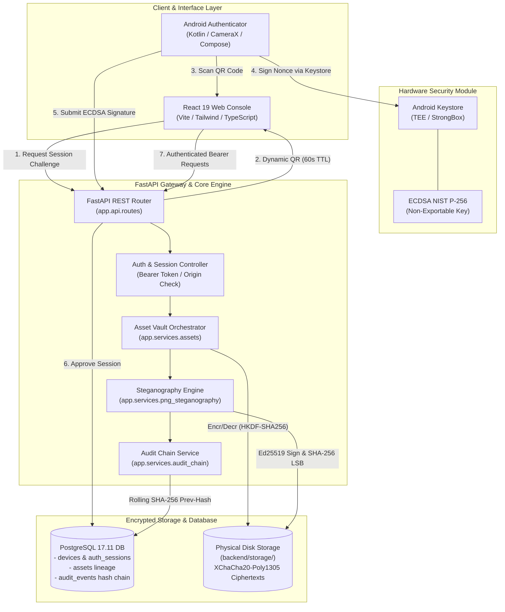

---

## Technology Stack

| Domain | Technologies |
| :--- | :--- |
| **Frontend Web Console** | React 19.3.1, Vite 8.3.6, TypeScript 7.0.2, Tailwind CSS 4.3.4, Lucide React, Axios |
| **Backend Core API** | Python 3.13.2, FastAPI 0.115, Starlette, Uvicorn, Pydantic v2 |
| **Database & Migrations**| PostgreSQL 17.11, SQLAlchemy 2.0, Psycopg 3, Alembic (Migrations 0001–0009) |
| **Cryptographic Suite** | PyCA/Cryptography (Ed25519, XChaCha20-Poly1305, HKDF, SHA-256, ECDSA NIST P-256) |
| **Image Processing** | Pillow (PIL Fork) 11.x (8-bit truecolor RGB/RGBA raster manipulation) |
| **Mobile Hardware Client**| Android SDK (API 28–36), Kotlin, Jetpack Compose, Android Keystore, CameraX, ZXing |
| **Testing & Automation** | Pytest 9.2, Playwright Chromium, AnyIO |

---

## System Workflow

```
[ Master PNG Upload ]
         │
         ▼
[ In-Memory Preview & Metadata ] ── (XChaCha20-Poly1305 Encrypted to Vault)
         │
         ▼
[ Configure Watermark ] ─────────── (Auto-bind Hardware ID, Ed25519 Key ID, SHA-256 Digest)
         │                          (Custom: Copyright, License, Statement, Description)
         ▼
[ LSB Embedding Engine ] ────────── (1-bit LSB in row-major RGB channels)
         │                          (IPGW v1 Binary Framing + Ed25519 Digital Signature)
         ▼
[ Encrypted Derivative Created ] ── (Lineage: source_asset_id linked; audit chain appended)
         │
    ┌────┴───────────────────────────┬──────────────────────────────┐
    ▼                                ▼                              ▼
[ Download Watermarked PNG ]   [ Verify Watermark ]          [ Extract Metadata ]
  (Decrypted byte-for-byte;      (Live validation of           (Structured JSON & text;
   valid truecolor PNG file)      Ed25519 & SHA-256 digest)     strictly fail-closed on tamper)
```

---

## Visual Documentation

Complete, privacy-audited visual evidence covering the redesigned Web Console, physical Android Authenticator (`SM-A546E`), source-verified architecture & cryptography diagrams, and live verification outputs is organized in [`docs/visual-evidence/`](docs/visual-evidence/README.md):

| System Architecture | Web Security Overview |
| :---: | :---: |
| 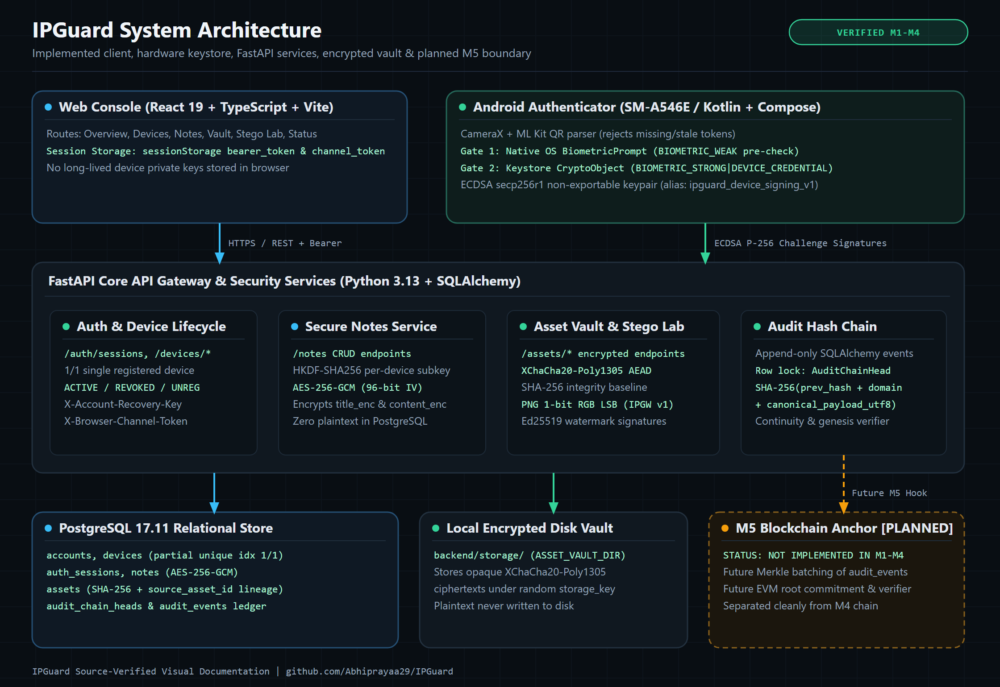 | 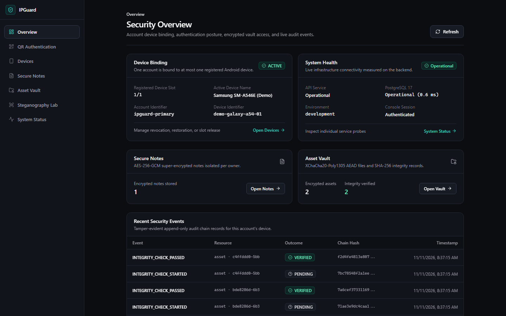 |
| *Implemented client, TEE keystore, FastAPI services, encrypted vault & planned M5 boundary.* | *Redesigned Web Console overview showing `1/1` device slot, health telemetry & audit chain.* |

| Device Lifecycle Management | Digital Asset Vault | Android Authenticator (`SM-A546E`) |
| :---: | :---: | :---: |
| 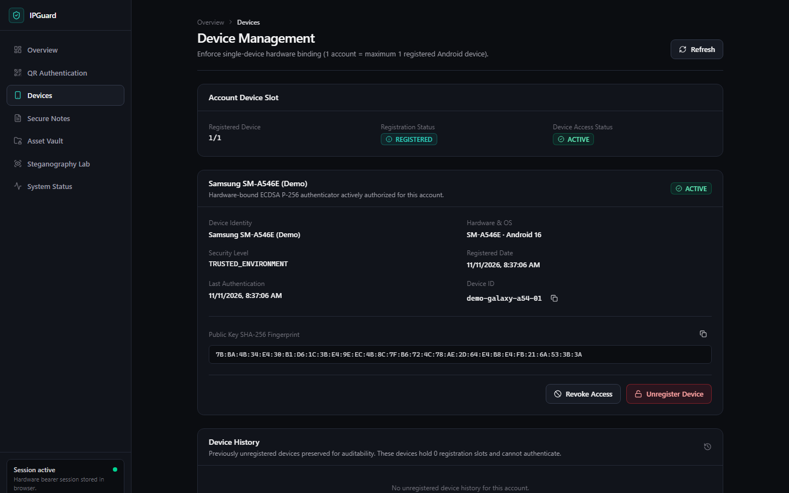 | 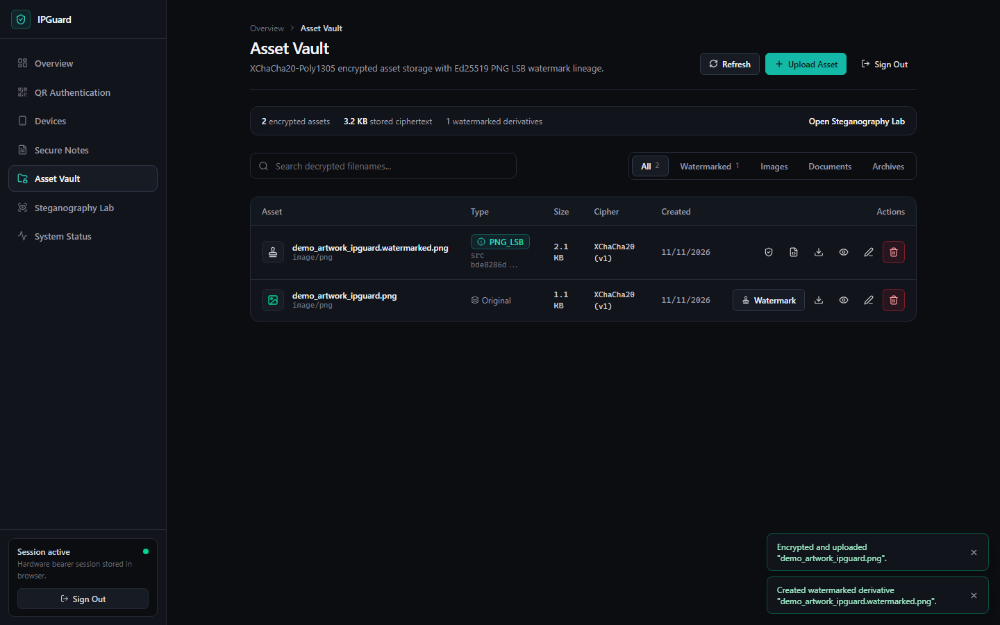 | 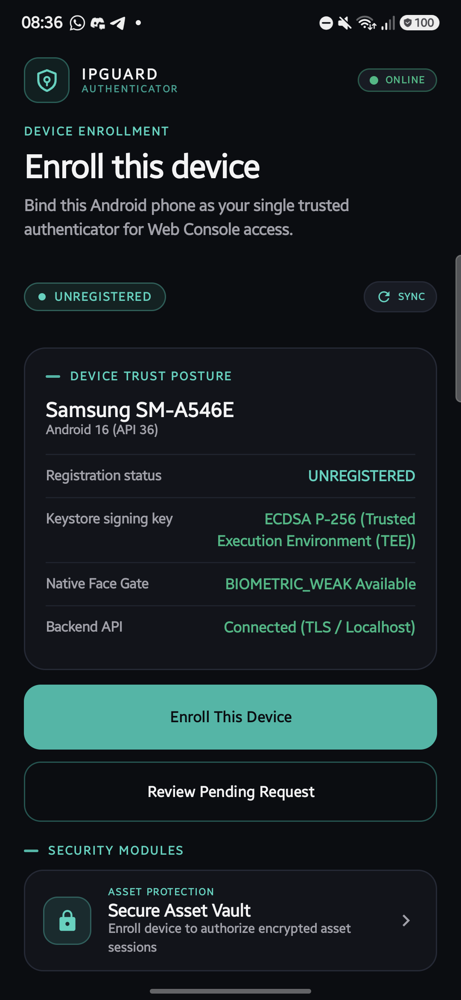 |
| *Single-device hardware binding (`ACTIVE` / `REVOKED` / `UNREGISTERED`).* | *XChaCha20-Poly1305 encrypted files & `PNG_LSB` watermark lineage.* | *Physical Galaxy A54 5G (`Android 16`) authenticator home & posture.* |

👉 [**View Complete Visual Evidence Catalog (`docs/visual-evidence/README.md`)**](docs/visual-evidence/README.md) · 🔒 [**Privacy Review (`docs/visual-evidence/PRIVACY_REVIEW.md`)**](docs/visual-evidence/PRIVACY_REVIEW.md)

---

## Screenshots & Visual Showcase

All screenshots were captured directly during automated Playwright browser acceptance testing on Chromium (1366x860) against live services:

| Asset Vault Overview | Uploaded Master Image |
| :---: | :---: |
| 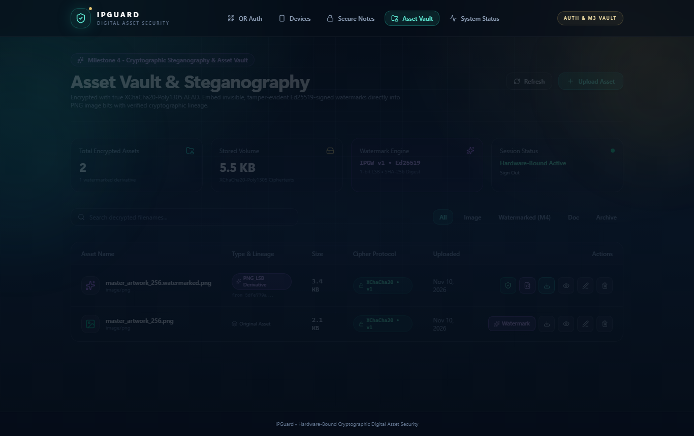 | 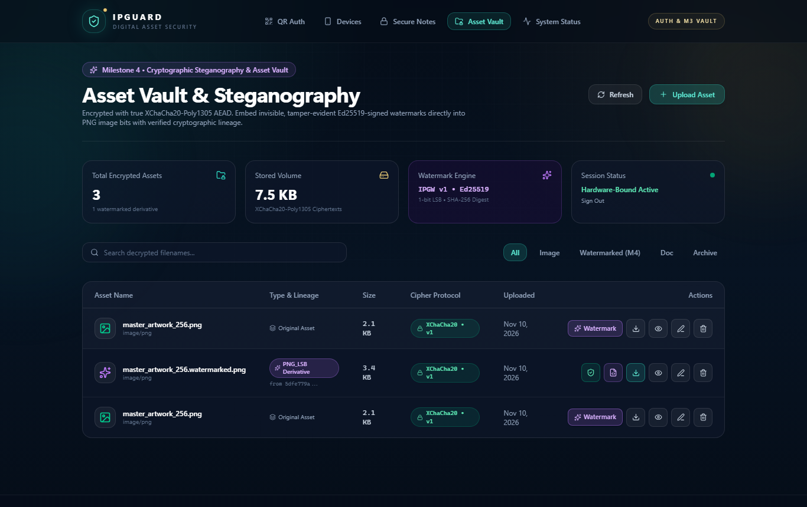 |
| *Hardware-authenticated console with active device status.* | *Original master PNG uploaded and encrypted with AEAD.* |

| Watermark Configuration | Embedding Success State |
| :---: | :---: |
| 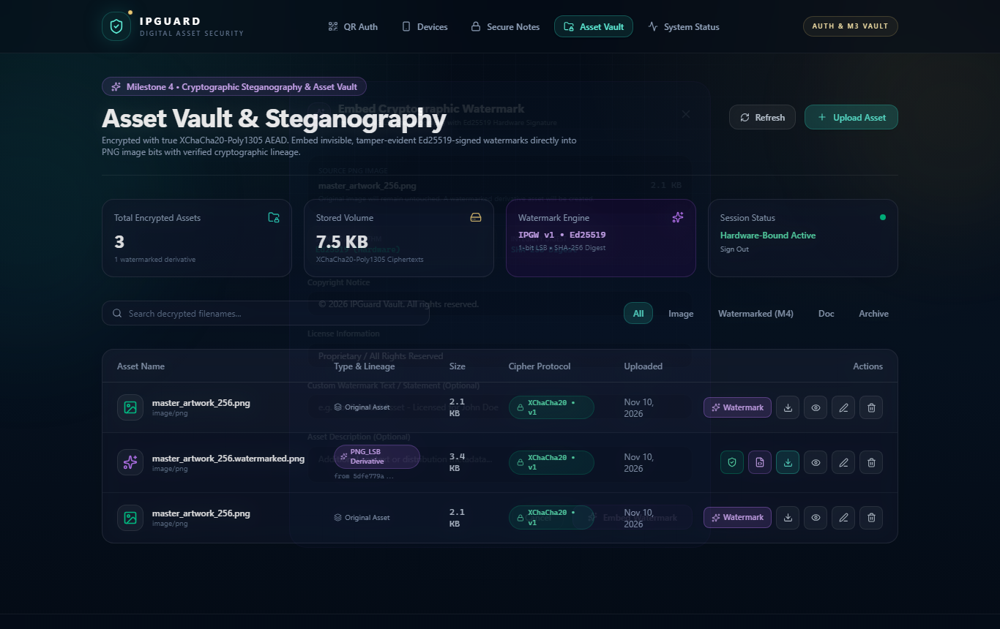 | 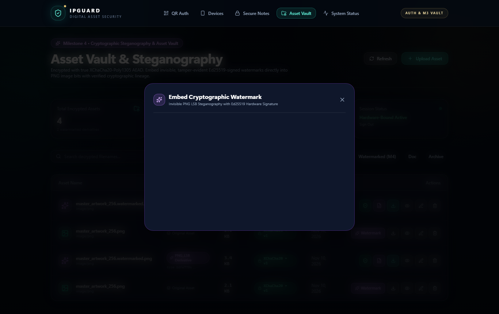 |
| *Auto-bound cryptographic parameters and custom metadata form.* | *Derivative asset created with verified Ed25519 signature.* |

| Derivative Vault Listing | Cryptographic Verification |
| :---: | :---: |
| 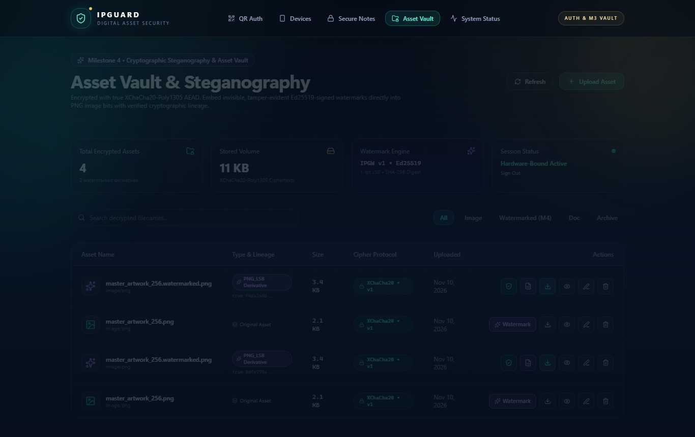 | 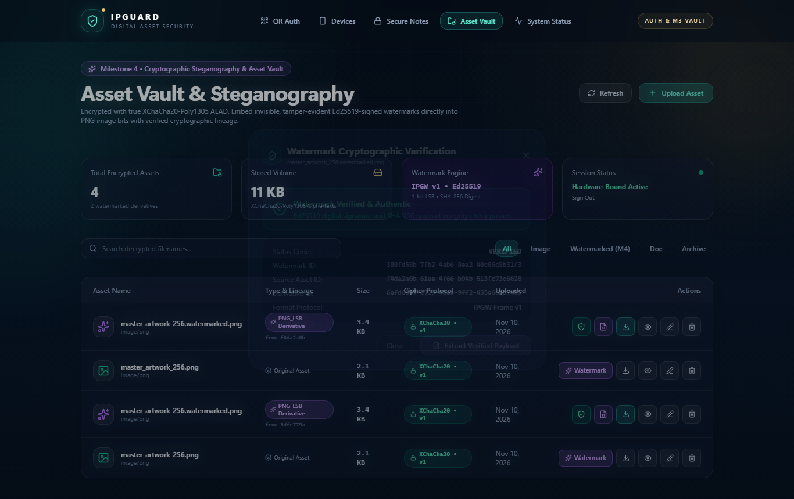 |
| *Derivative record linked to parent (`from 5dfe779a...`).* | *Live validation of Ed25519 signature and SHA-256 integrity.* |

| Extracted Metadata Modal | Technical Inspect Panel |
| :---: | :---: |
| 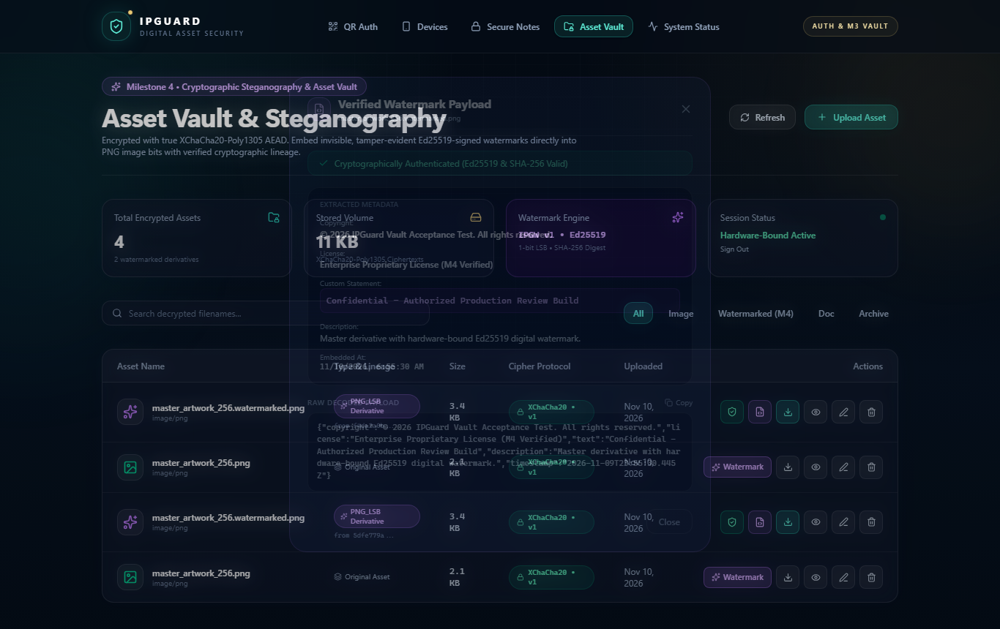 | 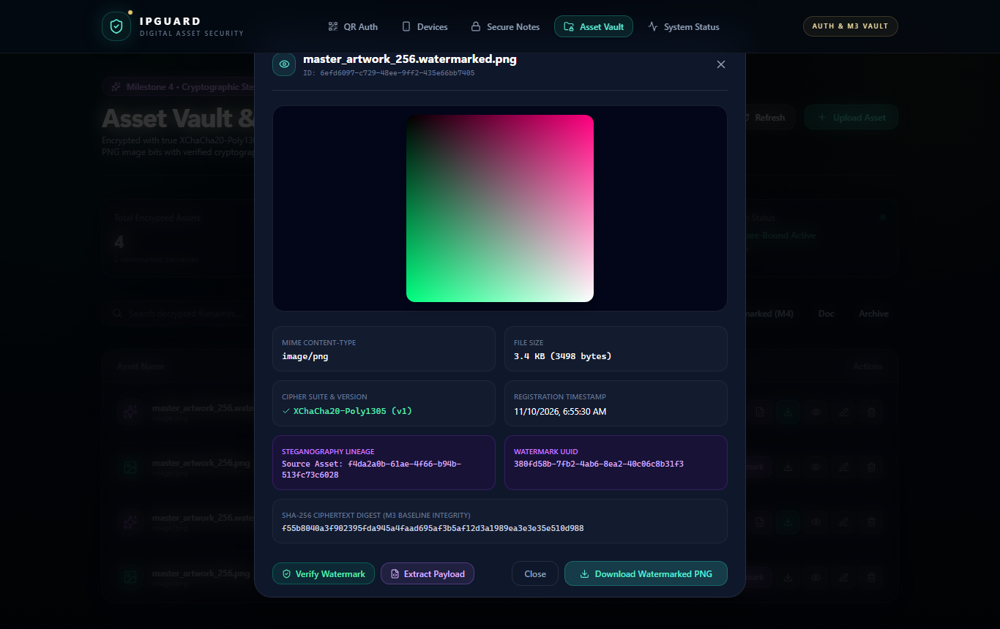 |
| *Structured metadata cards and raw JSON decoded from pixels.* | *Decrypted thumbnail preview and technical cipher specifications.* |

---

## Getting Started & Installation

### Prerequisites
* **Python:** 3.13.x (or `>= 3.11`)
* **Node.js:** `>= 22.12.0` (with npm 10+)
* **PostgreSQL:** `17.x` (17.11 recommended)
* **Android Studio:** Ladybug or newer (for mobile authenticator)

### 1. Database Setup
Ensure PostgreSQL is active and create the database user:
```sql
CREATE USER ipguard WITH PASSWORD 'your_secure_password';
CREATE DATABASE ipguard OWNER ipguard;
```

### 2. Backend Setup
```bash
cd backend
python -m venv .venv
source .venv/bin/activate  # On Windows: .\.venv\Scripts\Activate.ps1
pip install -r requirements.txt

# Configure environment
cp .env.example .env
# Edit .env and supply your DATABASE_URL and local dev keys

# Run database migrations (0001 through 0009)
alembic upgrade head

# Start FastAPI server
uvicorn app.main:app --host 127.0.0.1 --port 8000 --reload
```
API Documentation will be live at: `http://127.0.0.1:8000/docs`

### 3. Frontend Setup
```bash
cd ../frontend
npm install
cp .env.example .env
npm run dev
```
Web Console will be accessible at: `http://127.0.0.1:5173`

### 4. Android Authenticator Setup & APK Distribution
1. See [mobile-authenticator/README.md](mobile-authenticator/README.md) for local debug builds (`.\gradlew.bat assembleDebug --no-daemon`) and Android SDK setup.
2. Signed production/beta APKs are produced through [`.github/workflows/android-release.yml`](.github/workflows/android-release.yml) once repository signing secrets (`ANDROID_KEYSTORE_BASE64`, `ANDROID_KEYSTORE_PASSWORD`, `ANDROID_KEY_ALIAS`, `ANDROID_KEY_PASSWORD`) are configured.
3. Use ADB reverse proxy if testing locally over USB:
   ```bash
   adb reverse tcp:8000 tcp:8000
   adb reverse tcp:5173 tcp:5173
   ```

#### Installation & Security Highlights
- **Private Repository Access:** `Abhiprayaa29/IPGuard` is a private repository; authorized GitHub access is required to download release assets once published.
- **Installation Steps (Signed APK):** Download the signed release APK + `SHA256SUMS.txt` from GitHub Releases -> verify SHA-256 -> open APK on Android (API 28+) -> allow installation from the chosen source -> complete One-Time Device Enrollment.
- **Security Stack:** Android Keystore (`ECDSA P-256`), Native Android `BiometricPrompt`, and QR Challenge-Response Authentication.

---

## Testing & Quality Verification

IPGuard enforces strict verification across all layers:

### 1. Backend Pytest Test Suite
```bash
cd backend
pytest -v
```
* **Status:** **209 passed, 0 failed, 0 skipped** across all M1, M2, M3, and M4 modules.
* **Concurrency:** Includes `test_audit_chain_postgres.py` row-lock serialization across 24 concurrent threads.

### 2. Frontend Static Check & Production Build
```bash
cd frontend
npm run typecheck    # TypeScript strict mode: 0 errors
npm run build        # Production bundle compiled cleanly via Vite
```

### 3. Automated Real Browser Acceptance Testing (Playwright)
```bash
cd backend
python ../scripts/m4_browser_acceptance_test.py
```
* **Status:** 14-step automated user journey passed with **0 browser errors** and **0 failed network requests**.
* **Distortion Verification:** $\text{MSE} = 0.009471$, $\text{PSNR} = 68.37\text{ dB}$ *(imperceptible watermark quality on 256x256 test sample)*.

---

## Security Architecture & Cryptographic Design

| Cryptographic Primitive | Role in IPGuard | Implementation Details |
| :--- | :--- | :--- |
| **XChaCha20-Poly1305** | Authenticated Storage Encryption | 192-bit CSPRNG nonces, 128-bit Poly1305 MAC tags. Protects all file ciphertexts at rest. |
| **AES-256-GCM** | Secure Notes Encryption | 96-bit random IVs, 128-bit authentication tags. Encrypts personal notes records. |
| **HKDF-SHA256** | Key Derivation Pipeline | Derives deterministic per-device subkeys from master keys, ensuring tenant isolation. |
| **SHA-256** | Integrity Hashing & Checksums | Computes ciphertext baselines, payload integrity hashes, and rolling audit chain event hashes. |
| **Ed25519 (256-bit)** | Steganographic Attribution | Asymmetric digital signature proving watermark authenticity under the trusted key. |
| **ECDSA NIST P-256** | Hardware Device Authentication | Non-exportable keys in Android Keystore used to sign out-of-band login challenges. |
| **Spatial LSB Framing** | Invisible Watermarking | Embeds 170-byte fixed `IPGW` v1 binary frames into 1-bit LSBs of RGB pixel channels. |
| **Audit Hash Chain** | Non-Repudiation Audit Ledger | Sequential SHA-256 event linking ($\text{EventHash}_n = \text{SHA-256}(\text{EventHash}_{n-1} \parallel \dots)$). |

---

## Implementation Boundaries & Known Limitations

### Scope & Implementation Status
* **Milestones M0–M4:** **Implemented, Verified, and Fully Documented** in this repository.
* **Milestone 5 (Blockchain Audit Logging):** **Planned Future Roadmap, NOT Implemented.**
* **Native Face Authentication Gate (`BiometricPrompt` `BIOMETRIC_WEAK`):** **Implemented & Physically Verified** on Samsung Galaxy A54 5G (`SM-A546E`) as a pre-signing gate prior to Android Keystore `CryptoObject` (`BIOMETRIC_STRONG` / `DEVICE_CREDENTIAL`) ECDSA P-256 signing. Public Android API `BIOMETRIC_WEAK` selects strength tier rather than forcing face-only modality on all OEM hardware.
* **Production Status:** **Verified Engineering Evaluation / Pre-Release Build (`v1.0.0-m0-m4`).** This project is prepared for reproducible evaluation and testing in verified environments; no live production cloud deployment is claimed.

### Technical & Cryptographic Limitations
1. **Spatial LSB Fragility:** Spatial LSB steganography is fragile by design. Resizing, cropping, filtering, or lossy re-compression (JPEG/WebP) will alter pixel bits and intentionally invalidate the Ed25519 signature and SHA-256 checksum. It is not robust watermarking.
2. **Format Scope:** LSB steganography is strictly restricted to 8-bit truecolor RGB/RGBA PNG images.
3. **Hardware Device Validation:** Automated regression testing utilizes cryptographic test fixtures; physical Android device acceptance requires manual QR scanning on physical hardware.
4. **Legal Scope:** An Ed25519 digital signature establishes mathematical authenticity under the signing key; it does not constitute an independent legal copyright certificate without registered legal title.
5. **Sample-Specific PSNR Metrics:** Peak Signal-to-Noise Ratio for embedded watermarks is **68.37 dB** on the 256x256 master test image (`master_artwork_256.png`), with baseline variations (~61.94 dB) depending on image dimensions and carrier bit density. Both values substantially exceed the universal human imperceptibility threshold ($> 40\text{ dB}$).

---

## Future Roadmap

### Milestone 5 — Blockchain-Based Immutable Audit Logging (PLANNED)
* **Merkle Tree Aggregation:** Periodic batching of `audit_events` into cryptographic Merkle Trees.
* **Smart Contract Anchoring:** Publishing Merkle roots to public or consortium EVM blockchains (Ethereum, Polygon, or Arbitrum) for decentralized immutability.
* **Public Verifier Portal:** Web tool allowing third parties to verify asset hashes against blockchain checkpoints without requiring server access.

### Future Android Client Enhancements (PLANNED)
* **Remote Attestation:** Keymaster / Keymint certificate chain verification to validate hardware TEE integrity against Google servers.

---

## Documentation Hub

GitHub is the central documentation repository for IPGuard. Complete documentation can be navigated directly:

* 📚 [**Central Documentation Index (`docs/README.md`)**](docs/README.md) — Master navigation catalog.

### Core Architecture & Technical Specifications
* 🏛️ [**System Architecture (`docs/SYSTEM_ARCHITECTURE.md`)**](docs/SYSTEM_ARCHITECTURE.md) — Component topology, technology stack, and directory structure.
* 🔐 [**Security Architecture (`docs/SECURITY_ARCHITECTURE.md`)**](docs/SECURITY_ARCHITECTURE.md) — Threat model, cryptographic primitives, and `IPGW` binary framing.
* 🔄 [**Data Flow Specifications (`docs/DATA_FLOW.md`)**](docs/DATA_FLOW.md) — Sequence flows for enrollment, QR auth, upload, embedding, and verification.
* 📜 [**PNG Steganography Specification (`docs/png-lsb-steganography.md`)**](docs/png-lsb-steganography.md) — Byte-level `IPGW` framing layout.
* ⛓️ [**Audit Hash Chain Architecture (`docs/audit-hash-chain-deployment.md`)**](docs/audit-hash-chain-deployment.md) — Linear non-repudiation ledger design.

### Master Project Reports & Governance
* 📋 [**Final Master Project Report (`docs/FINAL_PROJECT_REPORT.md`)**](docs/FINAL_PROJECT_REPORT.md) — 20-section formal audit report (Indonesian).
* 🎯 [**Final Acceptance Matrix (`docs/FINAL_ACCEPTANCE_MATRIX.md`)**](docs/FINAL_ACCEPTANCE_MATRIX.md) — 26-feature verification matrix across M1–M4.
* 🗂️ [**Final Evidence Index (`docs/FINAL_EVIDENCE_INDEX.md`)**](docs/FINAL_EVIDENCE_INDEX.md) — Index of all test scripts, outputs, and database migrations.
* 🚀 [**Final Operational Handover (`docs/FINAL_HANDOVER.md`)**](docs/FINAL_HANDOVER.md) — Operator runbook and execution guides.
* 🧊 [**Final Freeze Report (`docs/FINAL_FREEZE_REPORT.md`)**](docs/FINAL_FREEZE_REPORT.md) — Pre-freeze audit and verification report.
* 🏷️ [**GitHub Release Report (`docs/FINAL_GITHUB_RELEASE_REPORT.md`)**](docs/FINAL_GITHUB_RELEASE_REPORT.md) — Release branch, tag, and PR #9 details.

### Milestone Verification Reports
* **M0:** [`docs/M0_TECHNICAL_FEASIBILITY.md`](docs/M0_TECHNICAL_FEASIBILITY.md) · [`docs/M0_COMPATIBILITY_REPORT.md`](docs/M0_COMPATIBILITY_REPORT.md)
* **M1:** [`docs/M1_TEST_REPORT.md`](docs/M1_TEST_REPORT.md) · [`docs/DEVELOPMENT_SETUP.md`](docs/DEVELOPMENT_SETUP.md)
* **M2:** [`docs/M2_MASTER_FINAL_AUDIT_REPORT.md`](docs/M2_MASTER_FINAL_AUDIT_REPORT.md) · [`docs/M2_ARCHITECTURE.md`](docs/M2_ARCHITECTURE.md) · [`docs/M2.3A_KEYSTORE_REPORT.md`](docs/M2.3A_KEYSTORE_REPORT.md) · [`docs/ONE_TIME_DEVICE_ENROLLMENT.md`](docs/ONE_TIME_DEVICE_ENROLLMENT.md)
* **M3:** [`docs/M3_FINAL_SECURITY_REVIEW.md`](docs/M3_FINAL_SECURITY_REVIEW.md) · [`docs/M3_ASSET_VAULT_BROWSER_E2E_REPORT.md`](docs/M3_ASSET_VAULT_BROWSER_E2E_REPORT.md) · [`docs/M3_ALIZA_ASSET_VAULT_INTEGRATION.md`](docs/M3_ALIZA_ASSET_VAULT_INTEGRATION.md)
* **M4:** [`docs/M4_FINAL_ACCEPTANCE_REPORT.md`](docs/M4_FINAL_ACCEPTANCE_REPORT.md) · [`docs/M4_BROWSER_ACCEPTANCE_REPORT.md`](docs/M4_BROWSER_ACCEPTANCE_REPORT.md) · [`docs/M4_BACKEND_TEST_REPORT.md`](docs/M4_BACKEND_TEST_REPORT.md) · [`docs/M4_FRONTEND_TEST_REPORT.md`](docs/M4_FRONTEND_TEST_REPORT.md)

### Visual Evidence & Acceptance Screenshots
* 🖼️ [**Browser Acceptance Screenshots Directory (`docs/screenshots/m4_acceptance/`)**](docs/screenshots/m4_acceptance/)
* 📊 [**Machine-Readable Acceptance Results (`docs/screenshots/m4_acceptance/acceptance_results.json`)**](docs/screenshots/m4_acceptance/acceptance_results.json)

---

## License & Usage

Copyright © 2026 IPGuard Project. All rights reserved.  
Proprietary academic and technical evaluation codebase.
