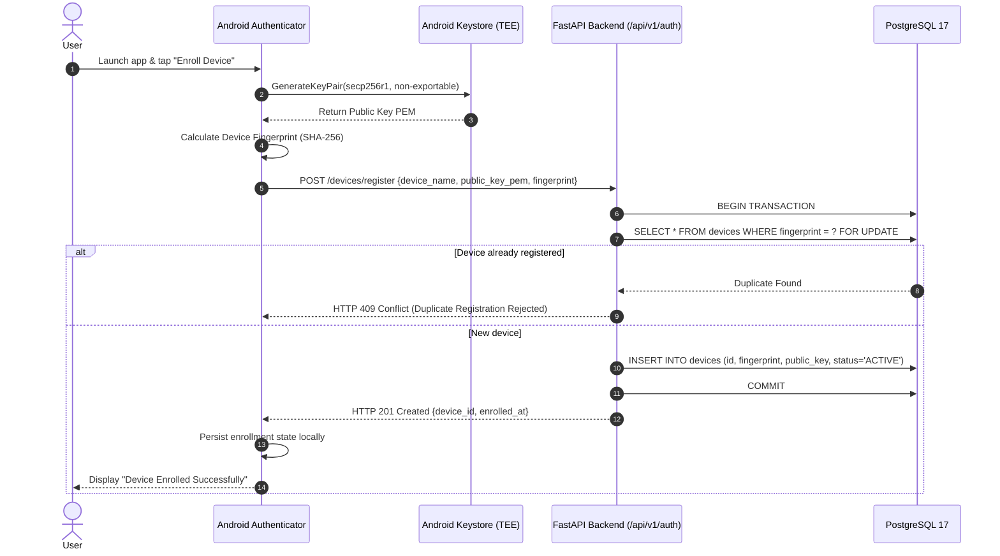
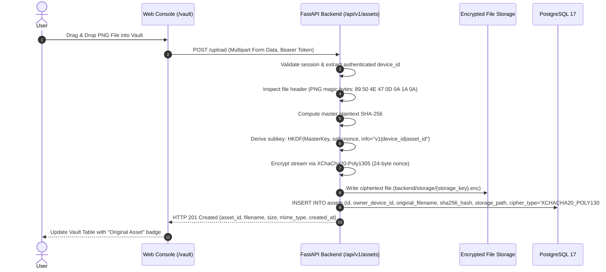
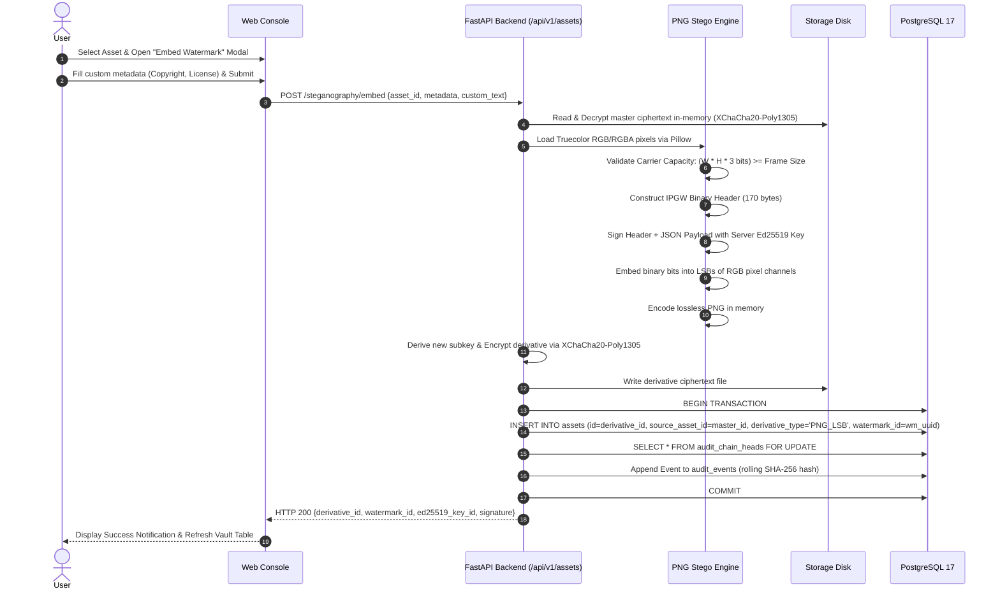
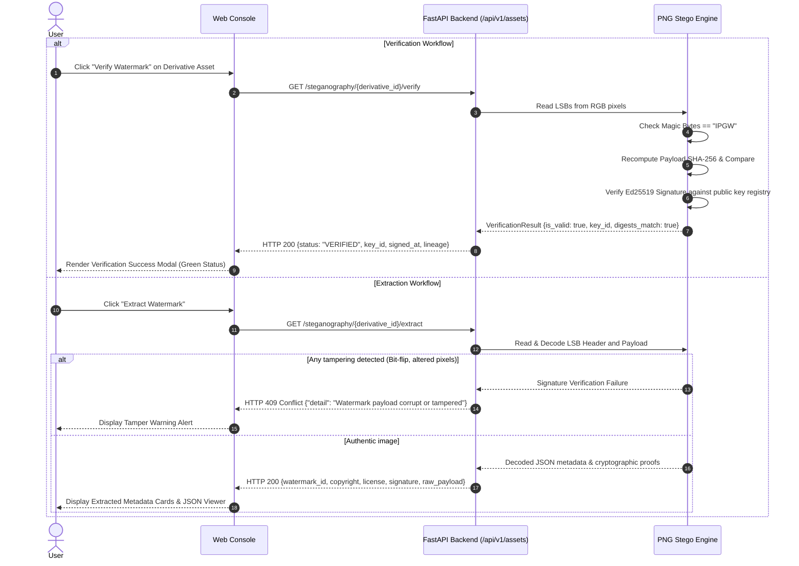
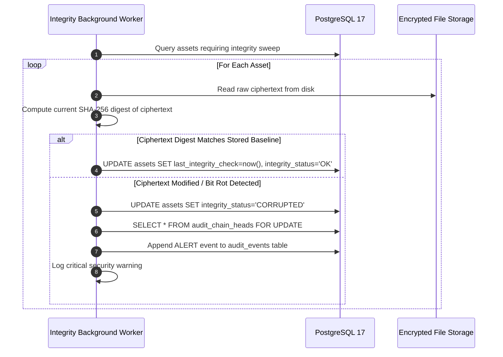

# IPGuard — Data Flow Documentation

**Document ID:** `docs/DATA_FLOW.md`  
**Classification:** Operational Data Flow Specification  
**Status:** Frozen & Verified (Milestones M0–M4)  
**Last Updated:** November 10, 2026  

---

## 1. Overview

This document specifies the end-to-end data pipelines and sequence flows across the IPGuard ecosystem. All flows preserve strict confidentiality, authenticated integrity, and verifiable non-repudiation.

---

## 2. Flow 1: Device Registration & Hardware Keystore Enrollment (M2)

Enrolls a physical Android smartphone as an authorized hardware authenticator.



---

## 3. Flow 2: Web QR Authentication Handshake & Session Activation (M2)

Facilitates passwordless login to the Web Console using the enrolled hardware authenticator.

```mermaid
sequenceDiagram
    autonumber
    actor User
    participant Web as Web Console (Browser)
    participant API as FastAPI Backend (/api/v1/auth)
    participant DB as PostgreSQL 17
    participant Android as Android Authenticator
    participant Keystore as Android Keystore (TEE)

    User->>Web: Open IPGuard Web Console
    Web->>API: POST /sessions/challenge
    API->>API: Generate Nonce (CSPRNG 32 bytes) + Browser Secret
    API->>DB: INSERT INTO auth_sessions (session_id, challenge, status='PENDING', expires_at=now+60s)
    API-->>Web: HTTP 200 {session_id, challenge, qr_code_payload, browser_secret}
    Web->>Web: Store browser_secret in sessionStorage; render dynamic QR
    Web->>API: Poll GET /sessions/{session_id}/status (every 2s)

    User->>Android: Open CameraX QR Scanner & Point to Screen
    Android->>Android: Decode QR payload {session_id, challenge}
    User->>Android: Confirm Login Approval
    Android->>Keystore: Sign challenge with private key (ECDSA P-256 + SHA-256)
    Keystore-->>Android: Return DER signature
    Android->>API: POST /sessions/{session_id}/approve {device_id, signature_der}
    API->>DB: SELECT * FROM devices WHERE id = device_id
    API->>API: Verify ECDSA signature against stored public_key_pem
    API->>DB: UPDATE auth_sessions SET status='APPROVED', device_id=? WHERE id=?
    API-->>Android: HTTP 200 {status: "APPROVED"}

    Web->>API: Next poll GET /sessions/{session_id}/status
    API-->>Web: HTTP 200 {status: "APPROVED", exchange_token}
    Web->>API: POST /sessions/{session_id}/exchange {browser_secret, exchange_token}
    API->>API: Validate browser_secret & Issue JWT Bearer Token (300s TTL)
    API-->>Web: HTTP 200 {access_token, token_type: "bearer", device_id}
    Web->>Web: Save token in sessionStorage & Redirect to /vault
```

---

## 4. Flow 3: Asset Upload & Encrypted Storage Pipeline (M3)

Ingests user files into the secure vault without storing unencrypted plaintext on disk.



---

## 5. Flow 4: Steganographic Watermark Embedding Pipeline (M4)

Generates a watermarked derivative image signed with Ed25519 and embedded via 1-bit LSB.



---

## 6. Flow 5: Watermark Verification & Extraction Pipeline (M4)

Verifies and extracts cryptographic watermarks from an embedded PNG derivative.



---

## 7. Flow 6: Background Periodic Integrity Auditing (M4)

Validates the physical storage integrity and detects offline corruption or tampering.


