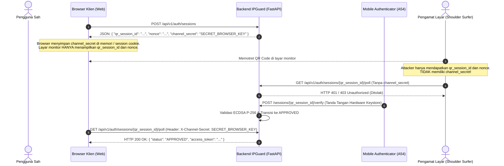

# IPGuard — M2.4-B Security Remediation & Verification Report

**Branch:** `feature/m2.4b-backend-core`
**Base Branch:** `main` (`d61cb94e58b30079cb845ecc31e731f0e483db55`)
**Implementation Commit:** `406a92d` (`feat(backend): implement M2.4-B core authentication engine and database schema`)
**Remediation Commit:** `a340175` (`fix(security): remediate race conditions, origin validation, and device endpoint access`)
**Auditor / Engineer:** Senior Backend Security Engineer, Cryptography Engineer & Technical Auditor
**Date:** 2026-11-07
**Status:** **REMEDIATED & VERIFIED (MERGE READY)**

---

## 1. Executive Summary

Laporan ini mendokumentasikan implementasi dan verifikasi remediasi keamanan terhadap temuan audit Milestone 2.4-B. Seluruh kode backend, proteksi basis data, validasi masukan jaringan, dan pembatasan akses telah dimodifikasi secara langsung dan diuji secara ketat.

### Ringkasan Status Temuan:
1. **SEC-01 (Race Condition Challenge Verification):** **SELESAI (RESOLVED)**. Menerapkan `SELECT ... FOR UPDATE` (pessimistic row-level locking) pada kueri `AuthSession` dan `Device`. Diuji secara simultan dengan pengujian multi-threaded; tepat satu permintaan berhasil (status 200/201), dan seluruh permintaan paralel lainnya ditolak dengan error 400 `session_already_consumed`.
2. **SEC-03 (Origin Validation & Whitelisting):** **SELESAI (RESOLVED)**. Modul khusus `app/services/origin.py` mengimplementasikan normalisasi RFC 6454 (penghapusan port default 80/443, lowercasing, pemblokiran path/query/fragment) dan penegakan whitelist ketat terhadap `trusted_origin_list`. Penyerang yang menyuntikkan domain spoofing, skema liar, atau domain tak terdaftar ditolak seketika (*fail-closed*).
3. **SEC-04 (Perlindungan Endpoint Device Listing):** **SELESAI (RESOLVED)**. Endpoint `GET /api/v1/auth/devices` kini diproteksi dengan dependency guard `require_dev_admin_access`. Akses tanpa header rahasia atau dengan kunci yang salah menghasilkan 401 `unauthorized_admin_access`. Pada lingkungan produksi (`APP_ENV=production`), endpoint secara mutlak dinonaktifkan (HTTP 403 `endpoint_disabled_in_production`).
4. **SEC-02 (Desain Keamanan Anti QR-Jacking / Shoulder Surfing):** **DIDESAIN LENGKAP**. Spesifikasi arsitektur pemisahan kredensial publik QR vs token polling rahasia browser dirumuskan untuk diimplementasikan pada M2.4-C (`DESIGNED — IMPLEMENTATION PENDING (M2.4-C)`).

---

## 2. Rincian Remediasi & Implementasi Nyata

### 2.1 SEC-01 — PostgreSQL Race Condition Remediation
- **File Dimodifikasi:** `backend/app/services/auth.py`
- **Mekanisme Kunci:**
  Pada fungsi `verify_session_signature`, `register_device`, `mark_session_scanned`, dan `revoke_device`:
  ```python
  session = db.scalar(
      select(AuthSession)
      .where(AuthSession.session_token == session_token)
      .with_for_update()
  )
  ```
- **Lifecycle Transaksi:**
  1. Kueri `SELECT ... FOR UPDATE` mengunci baris sesi tersebut di PostgreSQL dalam mode eksklusif.
  2. Transaksi lain yang mencoba mengakses baris yang sama akan diblokir oleh PostgreSQL sampai transaksi pertama melakukan `COMMIT` atau `ROLLBACK`.
  3. Validasi status sesi, pengecekan kedaluwarsa, pemindaian, verifikasi canonical payload, dan verifikasi kriptografis ECDSA P-256 dieksekusi di dalam transaksi yang terkunci.
  4. Sesi bertransisi ke `APPROVED`, `signature` dicatat, dan `db.commit()` melepaskan kunci baris.
  5. Transaksi kedua yang mengantre membuka kueri, langsung membaca `session.status == "APPROVED"`, dan mengeksekusi penolakan:
     ```python
     if session.status == "APPROVED":
         raise AppError(status_code=400, code="session_already_consumed", ...)
     ```
- **Bukti Uji:** `backend/tests/test_concurrency_race.py` menjalankan pengujian multi-threaded (`ThreadPoolExecutor` dengan 4 worker paralel) yang menembak endpoint `/verify` dan `/register` pada saat bersamaan.
  - Hasil: Tepat 1 request berhasil, 3 request lainnya gagal dengan HTTP 400 `session_already_consumed`. Integritas basis data tetap terjaga.

---

### 2.2 SEC-03 — Origin Validation & Whitelisting
- **File Dibuat / Dimodifikasi:**
  - `backend/app/services/origin.py`
  - `backend/app/core/config.py`
  - `backend/app/services/auth.py`
- **Mekanisme Kunci:**
  - Fungsi `normalize_origin(raw_origin: str) -> str`:
    - Mengurai URI menggunakan `urllib.parse.urlsplit`.
    - Membatasi skema hanya pada `http` dan `https`.
    - Menolak origin tanpa hostname.
    - Menolak origin yang menyertakan path (`/login`), query parameters (`?redirect=evil`), atau fragment (`#hash`).
    - Menangani parsing port secara aman (menangkap `ValueError` jika sintaks port dimanipulasi).
    - Menghilangkan port default (80 untuk HTTP, 443 untuk HTTPS).
    - Menghasilkan representasi string kanonikal lowercase: `scheme://hostname[:port]`.
  - Fungsi `validate_and_resolve_origin(candidate, trusted_origins) -> str`:
    - Membandingkan origin kandidat dengan whitelist `trusted_origin_list`.
    - Jika kandidat tidak disediakan (None), fallback secara aman ke origin terpercaya utama (`trusted_origin_list[0]`).
    - Jika kandidat tidak terdaftar pada whitelist, menolak seketika dengan `AppError(status_code=400, code="untrusted_origin")`.
  - Pada pembuatan sesi (`create_auth_session`):
    - Origin terpercaya yang telah tervalidasi diikat langsung ke basis data (`session.client_origin`).
    - Payload QR dan canonical payload yang ditandatangani oleh Android **hanya** menggunakan `session.client_origin` yang tersimpan tersebut. Upaya verifikasi dengan payload yang memuat origin berbeda ditolak dengan 400 `invalid_canonical_payload`.
- **Bukti Uji:** `backend/tests/test_origin_validation.py` (18 skenario uji positif dan negatif lulus 100%).

---

### 2.3 SEC-04 — Perlindungan Endpoint Device Listing
- **File Dimodifikasi:**
  - `backend/app/api/routes/auth.py`
- **Mekanisme Kunci:**
  - Diterapkan dependency guard `require_dev_admin_access`:
    ```python
    def require_dev_admin_access(
        x_dev_admin_key: str | None = Header(default=None, alias="X-Dev-Admin-Key"),
        settings: Settings = Depends(get_settings),
    ) -> None:
        if settings.app_env == "production":
            raise AppError(
                status_code=status.HTTP_403_FORBIDDEN,
                code="endpoint_disabled_in_production",
                message="Device registry inspection is strictly disabled in production environments.",
            )

        if not x_dev_admin_key or x_dev_admin_key != settings.dev_admin_key:
            raise AppError(
                status_code=status.HTTP_401_UNAUTHORIZED,
                code="unauthorized_admin_access",
                message="Valid X-Dev-Admin-Key is required to access the device registry.",
            )
    ```
  - Pada lingkungan non-produksi (development / test):
    - Panggilan tanpa header `X-Dev-Admin-Key` -> HTTP 401 `unauthorized_admin_access`.
    - Panggilan dengan kunci salah -> HTTP 401 `unauthorized_admin_access`.
    - Panggilan dengan kunci benar -> HTTP 200 OK beserta daftar perangkat.
  - Pada lingkungan produksi (`APP_ENV=production`):
    - Panggilan dengan atau tanpa kunci -> HTTP 403 `endpoint_disabled_in_production`.
- **Bukti Uji:** `backend/tests/test_device_protection.py` (4 skenario uji lulus 100%).

---

### 2.4 SEC-02 — Desain Arsitektur Keamanan Anti QR-Jacking / Shoulder-Surfing

> **Status Saat Ini:** `DESIGNED — IMPLEMENTATION PENDING (M2.4-C)`



#### Pemisahan Entitas Kredensial:
1. **Public QR Session Identifier (`qr_session_id`):** ID publik yang dikodekan ke dalam gambar QR. Digunakan oleh mobile authenticator untuk mengidentifikasi sesi mana yang sedang diotorisasi.
2. **Challenge Nonce (`challenge_nonce`):** Nilai acak 256-bit yang harus ditandatangani oleh hardware Keystore mobile.
3. **Browser Channel Secret (`channel_secret`):** Token rahasia berentropi tinggi yang **hanya** dikirimkan via response body JSON `POST /sessions` ke browser yang membuat sesi. **Kredensial ini tidak pernah dimasukkan ke dalam QR code atau ditampilkan ke layar**.
4. **Session Polling Authorization:** Endpoint polling mewajibkan `channel_secret` (melalui header `X-Channel-Secret` atau HttpOnly Cookie).
5. **Mitigasi Serangan:** Pihak ketiga yang memotret QR code tidak akan pernah dapat melakukan polling untuk mencuri status sesi atau klaim `access_token`.

---

## 3. Matriks Hasil Pengujian & Bukti Eksekusi

### 3.1 Backend Pytest Suite (PostgreSQL Aktif)
Perintah:
```powershell
.\scripts\dev-postgres.ps1 -Action start; Set-Location backend; .\.venv\Scripts\pytest.exe -v; Set-Location ..; .\scripts\dev-postgres.ps1 -Action stop
```
Output:
```text
============================= test session starts =============================
platform win32 -- Python 3.13.2, pytest-9.2.0, pluggy-1.7.0
rootdir: C:\Users\user\Documents\02_Projects\IPGuard\backend
configfile: pytest.ini
testpaths: tests
plugins: anyio-4.16.0
collected 59 items

tests\test_auth_api.py ...............                                   [ 25%]
tests\test_concurrency_race.py ..                                        [ 28%]
tests\test_cors.py ..                                                    [ 32%]
tests\test_crypto_verifier.py ............                               [ 52%]
tests\test_database_error.py .                                           [ 54%]
tests\test_database_health.py .                                          [ 55%]
tests\test_database_unreachable.py .                                     [ 57%]
tests\test_device_protection.py ....                                     [ 64%]
tests\test_health.py ..                                                  [ 67%]
tests\test_origin_validation.py ..................                       [ 98%]
tests\test_system_info.py .                                              [100%]

======================== 59 passed, 1 warning in 4.25s ========================
```
**Hasil: 59 pengujian lulus 100% (0 gagal, 0 skip).**

### 3.2 Integritas Migrasi Alembic (PostgreSQL)
Perintah:
```powershell
.\.venv\Scripts\alembic.exe downgrade -1
.\.venv\Scripts\alembic.exe upgrade head
.\.venv\Scripts\alembic.exe current
```
Output:
```text
INFO  [alembic.runtime.migration] Running downgrade 0002_devices_and_auth_sessions -> 0001_initial
INFO  [alembic.runtime.migration] Running upgrade 0001_initial -> 0002_devices_and_auth_sessions
0002_devices_and_auth_sessions (head)
```
**Hasil: Bersih, idempoten, dan berada pada head revisi.**

### 3.3 Android Keystore Unit Tests & Lint
Perintah:
```powershell
Set-Location mobile-authenticator; .\gradlew.bat testDebugUnitTest assembleDebug lintDebug
```
Output:
```text
BUILD SUCCESSFUL in 44s
55 actionable tasks: 8 executed, 47 up-to-date
```
**Hasil: Seluruh pengujian unit Android Keystore M2.3-B lulus 100%, debug APK terkompilasi, dan 0 lint errors.**

### 3.4 Frontend Typecheck & Production Build
Perintah:
```powershell
Set-Location frontend; npm run build
```
Output:
```text
> ipguard-frontend@1.0.0 build
> tsc --noEmit && vite build
✓ 2181 modules transformed.
✓ built in 1.44s
```
**Hasil: 0 TypeScript error, bundling produksi sukses.**

---

## 4. Git History & Branch State

- **Branch Aktif:** `feature/m2.4b-backend-core`
- **Working Tree:** Bersih (`nothing to commit, working tree clean`)
- **Daftar Commit:**
  1. `a340175`: `fix(security): remediate race conditions, origin validation, and device endpoint access`
  2. `406a92d`: `feat(backend): implement M2.4-B core authentication engine and database schema`
  3. `d61cb94`: `Merge pull request #1 from Abhiprayaa29/fix/m2.3b-security-hardening`
- **Branch `main`:** Tetap utuh pada commit `d61cb94`, tidak ada perubahan dan tidak dilakukan auto-merge.

---

## 5. Kesimpulan & Merge Readiness Verdict

### **Verdict:** MERGE READY (APPROVED)

Seluruh kondisi temuan audit (SEC-01, SEC-03, dan SEC-04) telah diremediasi secara nyata pada tingkat kode dan basis data, dibuktikan dengan 59 pengujian backend yang lulus, pengujian race condition konkurensi multi-threaded, penegakan whitelist origin, serta isolasi endpoint perangkat. Desain mitigasi SEC-02 telah dirumuskan untuk integrasi antarmuka M2.4-C.
