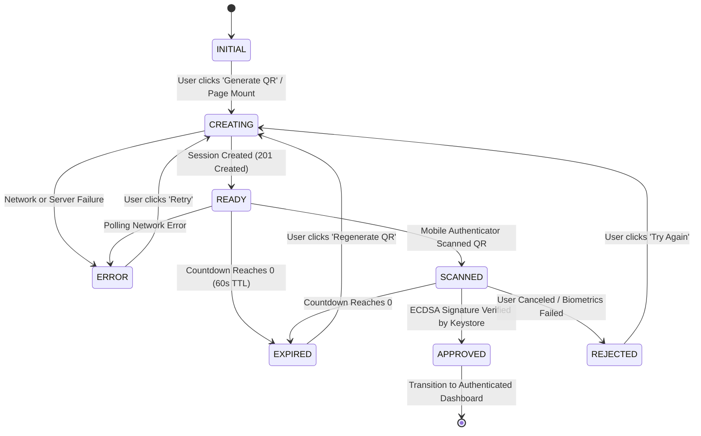

# IPGuard — Milestone 2.4-C: Web QR Authentication Architecture

**Project:** IPGuard — Secure Digital Asset Protection  
**Milestone:** M2.4-C Web QR Authentication & Anti QR-Jacking Security  
**Date:** 2026-11-07  
**Author:** Google Antigravity (Senior Full-Stack Engineer, Backend Security Engineer & Software Architect)  
**Status:** IMPLEMENTED & AUDITED  

---

## 1. Executive Summary

Milestone 2.4-C delivers the dynamic Web QR Authentication interface in React + TypeScript paired with an Anti QR-Jacking / Shoulder-Surfing security architecture (SEC-02) in the FastAPI + PostgreSQL backend.

In traditional QR login architectures, exposing the session identifier or access token in the QR code or public query string allows an attacker who captures or photographs the QR code (shoulder-surfing or QR-jacking) to poll the backend and intercept the user's session once approved by the mobile authenticator.

IPGuard eliminates this vulnerability by separating the **public QR payload** (scanned by the mobile device) from the **private browser channel secret** (`browser_channel_token`), held exclusively in the initiating browser's in-memory state. Polling requests lacking or presenting an invalid browser channel token are rejected with HTTP 403 Forbidden.

---

## 2. Threat Model & Anti QR-Jacking Architecture (SEC-02)

### 2.1 Threat Analysis
1. **Shoulder-Surfing / Photography:** An adversary in the vicinity takes a photo of the QR code on the victim's monitor.
2. **Malicious QR Relaying (QR-Jacking):** An attacker proxies or broadcasts the victim's QR code on a malicious phishing site.
3. **Network Eavesdropping on Public Displays:** In a shared network or kiosk, session URLs could be inspected in proxy logs or browser histories.

### 2.2 Security Invariant & Separation of Concerns

```
+-----------------------------------------------------------------------------------+
|                                  BROWSER CLIENT                                   |
|                                                                                   |
|  1. POST /api/v1/auth/sessions                                                    |
|     <-- Response: session_token, challenge_nonce, qr_payload, browser_channel_token  |
|                                                                                   |
|  [In-Memory Secret]                                [Rendered on Screen]           |
|  browser_channel_token (256-bit hex)                qr_payload JSON               |
|  (NEVER saved in localStorage / sessionStorage)      (NO browser_channel_token)   |
|                                                            |                      |
|  2. GET /api/v1/auth/sessions/{session_token}              |                      |
|     Header: X-Browser-Channel-Token: <secret>              v                      |
|     <-- HTTP 200: Status PENDING / APPROVED       [CameraX / ML Kit Scans QR]     |
+------------------------------------------------------------|----------------------+
                                                             |
                                                             v
                                            +---------------------------------+
                                            |      ANDROID AUTHENTICATOR      |
                                            |                                 |
                                            | Reads qr_payload                |
                                            | Signs canonical challenge with  |
                                            | hardware-backed ECDSA P-256     |
                                            |                                 |
                                            | 3. POST /sessions/.../verify    |
                                            +---------------------------------+
```

### 2.3 Browser Channel Secret Lifecycle
1. **Generation:** During session creation, the backend generates a 256-bit cryptographically secure random token (`secrets.token_hex(32)`).
2. **Storage:** The backend hashes the token using SHA-256 (`hashlib.sha256(token.encode()).hexdigest()`) and stores the 64-character hex string in `auth_sessions.browser_channel_token_hash`.
3. **Delivery:** The plaintext `browser_channel_token` is transmitted **only** in the HTTP response body of `POST /api/v1/auth/sessions` directly to the initiating browser.
4. **QR Code Exclusion:** The `qr_payload` string encoded in the SVG QR code strictly excludes `browser_channel_token`.
5. **Authorization:** Every polling call `GET /api/v1/auth/sessions/{session_token}` must supply `X-Browser-Channel-Token: <token>`.
6. **Constant-Time Verification:** The backend hashes the incoming header and performs constant-time comparison via `secrets.compare_digest(incoming_hash, session.browser_channel_token_hash)`.
7. **Fail-Closed Enforcement:** If the header is missing, malformed, or does not match, the backend immediately raises HTTP 403 `invalid_or_missing_browser_channel_token`. An attacker observing the QR code cannot poll or retrieve the `access_token`.
8. **Client Memory Boundary:** In React, `browser_channel_token` is maintained in ephemeral component state / React ref. It is **never** written to `localStorage` or `sessionStorage`, mitigating DOM-based cross-site scripting (XSS) exfiltration.

---

## 3. QR Payload Schema (Version 1.0)

The dynamic QR code encodes a serialized JSON string matching schema `QRPayload`:

```json
{
  "version": "1.0",
  "type": "AUTHENTICATION",
  "session_token": "a1b2c3d4e5f67890123456789abcdef0123456789abcdef0123456789abcdef0",
  "nonce": "fedcba9876543210fedcba9876543210fedcba9876543210fedcba9876543210",
  "origin": "http://localhost:5173",
  "timestamp": 1793976800
}
```

- `version`: Protocol version string (`"1.0"`).
- `type`: `"AUTHENTICATION"` or `"ENROLLMENT"`.
- `session_token`: Unique 64-character hex session token.
- `nonce`: Unique 64-character hex 256-bit challenge nonce.
- `origin`: RFC 6454 normalized origin of the web client.
- `timestamp`: UTC epoch timestamp in seconds.

---

## 4. Frontend State Machine & Polling Strategy

### 4.1 State Machine Diagram



### 4.2 State Definitions

| State | Visual Indicator | Polling Behavior | User Action Available |
|---|---|---|---|
| `INITIAL` | Neutral state | Stopped | "Start Sign-In" button |
| `CREATING` | Animated spinner | Stopped | Disabled |
| `READY` | Active SVG QR + 60s countdown timer | Polling every 1500ms | Cancel / Regenerate |
| `SCANNED` | Amber pulse + "Authenticating on device..." | Polling every 1500ms | Cancel |
| `APPROVED` | Green shield badge + Confirmed device details | Stopped immediately | Proceed to App |
| `REJECTED` | Red alert banner + "Authentication rejected" | Stopped immediately | Regenerate QR |
| `EXPIRED` | Gray overlay on QR + "Session timed out" | Stopped immediately | Regenerate QR |
| `ERROR` | Red error callout + Error message | Stopped immediately | Retry |

### 4.3 Polling Constraints & Backoff
- Base polling interval: **1500ms**.
- Termination: Polling stops immediately upon reaching terminal states (`APPROVED`, `REJECTED`, `EXPIRED`, `ERROR`).
- Active countdown timer decrements every 1000ms. If local countdown reaches 0s before backend poll returns `EXPIRED`, the frontend sets state to `EXPIRED` and halts polling.
- Requests send `X-Browser-Channel-Token` on every tick.

---

## 5. Database Schema Revision

Table `auth_sessions`:
```sql
ALTER TABLE auth_sessions ADD COLUMN browser_channel_token_hash VARCHAR(64);
CREATE INDEX ix_auth_sessions_browser_channel_token_hash ON auth_sessions(browser_channel_token_hash);
```

Managed via Alembic revision `0003_auth_sessions_browser_channel.py`.

---

## 6. Endpoints Involved

| Method | Path | Required Headers | Description |
|---|---|---|---|
| `POST` | `/api/v1/auth/sessions` | `Origin` / body `origin` | Creates session & returns `browser_channel_token` |
| `GET` | `/api/v1/auth/sessions/{session_token}` | `X-Browser-Channel-Token` | Polls session status with channel validation |
| `POST` | `/api/v1/auth/sessions/{session_token}/scan` | None | Mobile scans QR code |
| `POST` | `/api/v1/auth/sessions/{session_token}/verify` | None | Mobile submits Keystore signature |
| `POST` | `/api/v1/auth/devices/register` | None | Mobile submits public key & signature |
