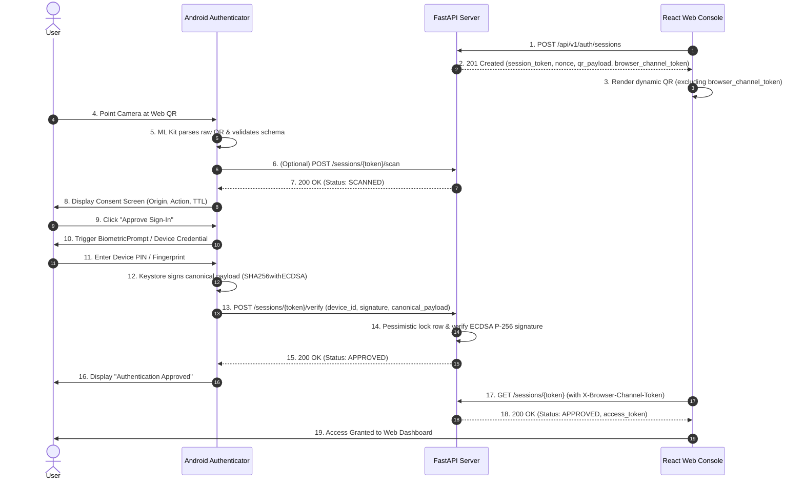

# IPGuard — Milestone 2.4-D: Android Authenticator Implementation Plan

**Project:** IPGuard — Secure Digital Asset Protection  
**Milestone:** M2.4-D Android Authenticator QR Parsing & Networking Integration  
**Target Device:** Samsung Galaxy A54 5G (SM-A546E), Android 16 / API 36  
**Author:** Google Antigravity (Senior Android Engineer, Mobile Security Engineer & Backend Integration Architect)  
**Date:** 2026-11-07  
**Status:** DRAFT & AUDITED — READY FOR IMPLEMENTATION  

---

## 1. Executive Summary

Milestone 2.4-D implements the critical cryptographic bridge between the native Android Authenticator and the FastAPI backend, turning the camera QR scanner into a real hardware-bound authenticator.

Building on the verified foundations of M2.2 (CameraX + ML Kit), M2.3-A (Android Keystore ECDSA P-256), M2.3-B (Adaptive Authentication with BiometricPrompt & Device Credential), and M2.4-C (Web QR and Anti QR-Jacking), this milestone adds:
1. Strict, fail-closed parsing and validation of Web QR payloads.
2. An asynchronous, secure networking layer built on OkHttp.
3. Consent review and authorization screens displaying origin and session details.
4. Canonical payload construction matching backend cryptographic requirements bit-for-bit.
5. End-to-end device registration (proof of possession) and authentication signing against the backend PostgreSQL engine.

---

## 2. Existing Architecture & Reused Modules

| Module | Location | Current Capability | Reuse Strategy in M2.4-D |
|---|---|---|---|
| **Camera & QR Analyzer** | `ui/camera/QrCodeAnalyzer.kt` | ML Kit Barcode Scanning with one-shot atomic gate | Update callback to deliver `barcode.rawValue: String` |
| **Android Keystore Manager** | `security/DeviceKeyManager.kt` | Non-exportable ECDSA P-256 key pair, X.509 DER export, SHA-256 fingerprint | Provide public key X.509 and private key for signing without re-generation |
| **Adaptive Authenticator** | `security/DeviceSigningAuthenticator.kt` | `BiometricPrompt` + `CryptoObject` supporting PIN/pattern/biometric | Sign canonical challenge payload with hardware key |
| **Authentication Policy** | `security/DeviceAuthenticationPolicy.kt` | Device credential & biometric capability detection | Verify hardware signing eligibility |
| **UI State & ViewModel** | `ui/state/AuthenticatorViewModel.kt` | Manages diagnostics & state flows | Add state machines for scanning, consent, networking, and signing |
| **Screens** | `ui/screens/` | 9 existing composable screens | Wire `QrScannerScreen`, `AuthenticationRequestScreen`, `ApprovalScreen`, `ResultScreen` |

---

## 3. Existing Backend API Contract

Reference: `docs/M2.4_API_CONTRACT.md` and OpenAPI routes in `backend/app/api/routes/auth.py`.

### 3.1 QR Payload Schema (Version 1.0)
```json
{
  "version": "1.0",
  "type": "AUTHENTICATION", // or "ENROLLMENT"
  "session_token": "<64-character hex string>",
  "nonce": "<64-character hex string>",
  "origin": "http://localhost:5173",
  "timestamp": 1793976800
}
```

### 3.2 Endpoints Utilized by Android
1. **Scan Notification (Optional / Telemetry):**
   - `POST /api/v1/auth/sessions/{session_token}/scan`
   - Body: `{"device_id": "<device_id>"}`
   - Status: `200 OK`
2. **Signature Verification (Sign-In):**
   - `POST /api/v1/auth/sessions/{session_token}/verify`
   - Body:
     ```json
     {
       "device_id": "<device_id>",
       "canonical_payload": "<session_token>:<nonce>:<origin>:<timestamp>",
       "signature": "<Base64 ASN.1 DER ECDSA P-256 signature>"
     }
     ```
   - Status: `200 OK`
3. **Device Enrollment (First-Time Registration):**
   - `POST /api/v1/auth/devices/register`
   - Body:
     ```json
     {
       "session_token": "<session_token>",
       "device_id": "<device_id>",
       "device_name": "Samsung Galaxy A54 5G",
       "model": "SM-A546E",
       "android_version": "16",
       "public_key_x509": "<Base64 SubjectPublicKeyInfo DER>",
       "security_level": "TRUSTED_ENVIRONMENT",
       "canonical_payload": "<session_token>:<nonce>:<origin>:<timestamp>",
       "signature": "<Base64 ASN.1 DER ECDSA P-256 signature>"
     }
     ```
   - Status: `201 Created`

---

## 4. Required Network Layer Architecture

### 4.1 Dependency Selection
- **OkHttp 4.12.0:** Standard, rock-solid, production-grade HTTP client for Android.
- **kotlinx.serialization.json or org.json:** Android framework natively includes `org.json.JSONObject`. Using lightweight serialization or `org.json` ensures zero ABI conflicts on Kotlin 2.2+.

### 4.2 Architecture Structure
```text
com.ipguard.authenticator.network/
├── ApiClient.kt             // OkHttp client configuration & timeouts (10s connect, 15s read)
├── AuthApiService.kt        // Network operations (scanSession, verifySession, registerDevice)
├── NetworkModels.kt         // DTOs for requests and responses
├── ApiResult.kt             // Sealed class: Success, HttpError, NetworkError, SecurityError
└── NetworkConfig.kt         // Base URL resolution (BuildConfig / Local Development)
```

### 4.3 Network Security & Development Connectivity
- **Production Boundary:** HTTPS required, default system TLS trust manager, no trust-all verifiers, no cleartext traffic.
- **Local Development Connectivity:**
  - When testing against a local laptop server from a physical Samsung A54 over Wi-Fi, `localhost` points to the phone itself.
  - Development configuration supports:
    a) ADB Reverse Port Forwarding (`adb reverse tcp:8000 tcp:8000`), allowing phone to hit `http://127.0.0.1:8000` via USB cable!
    b) Configurable LAN IP (e.g. `http://192.168.x.x:8000`).
  - To support local debug HTTP without compromising production security:
    - Add `network_security_config.xml` scoped exclusively to debug builds (`android:networkSecurityConfig="@xml/network_security_config"` with cleartext permitted only for `127.0.0.1`, `localhost`, and LAN addresses).
    - Release builds strictly enforce HTTPS.

---

## 5. QR Parsing & Validation Layer

### 5.1 Package: `com.ipguard.authenticator.security.qr`
- `QrAuthPayload.kt`: Immutable data model representing verified challenge.
- `QrAuthPayloadParser.kt`: Strict parser with length bounds (max 2048 bytes), strict regex checks (64 hex characters for tokens and nonces), allowed session types (`AUTHENTICATION`, `ENROLLMENT`), and TTL sanity checks.
- `QrPayloadValidationResult.kt`: Sealed result hierarchy (`Valid`, `InvalidJson`, `UnsupportedVersion`, `InvalidFormat`, `Expired`, `UntrustedOrigin`).

### 5.2 Critical Anti QR-Jacking Boundary
- Android never requests, parses, or forwards `browser_channel_token`.
- If an adversary attempts to inject `browser_channel_token` into the QR code, the parser can flag or ignore it, preserving separation of concerns.

---

## 6. Canonical Signing Payload Compatibility

The backend verifies `canonical_payload` matching:
`f"{session_token}:{nonce}:{origin}:{timestamp}"`

- Fields must be concatenated with `:` delimiter.
- No whitespace or newline padding.
- Timestamp must be exact integer from QR payload.
- UTF-8 byte encoding.
- Signed via `SHA256withECDSA` returning ASN.1 DER encoded `(r, s)`.
- Base64 encoded using standard RFC 4648.

---

## 7. State Machine & User Consent Flow



---

## 8. Physical Test Plan (Samsung Galaxy A54)

- Physical device connected via ADB (`SM-A546E`, Android 16 / API 36).
- Test vectors:
  - D-01: QR scan detection via CameraX rear camera.
  - D-02 to D-09: Unit & manual test cases for valid and malformed payloads.
  - D-10: Backend scan notification.
  - D-11 to D-14: Consent confirmation and BiometricPrompt system PIN prompt.
  - D-15: Successful signature submission and backend 200 OK approval.
  - D-19: First-time device enrollment with hardware public key.
  - D-22: Network interruption handling.

---

## 9. Potential Blockers & Mitigations
1. **Physical Device to Host Networking:** Physical phone cannot reach `localhost:8000` directly.
   - *Mitigation:* Execute `adb reverse tcp:8000 tcp:8000` so that `http://127.0.0.1:8000` maps through USB directly to host FastAPI server.
2. **Cleartext HTTP Restrictions:** Android 9+ blocks cleartext HTTP by default.
   - *Mitigation:* Provide dedicated debug `network_security_config.xml` permitting cleartext only for `127.0.0.1` and `localhost` in debug builds.
3. **Android Keystore Key Lifetime:** Existing key `ipguard_device_signing_v1` on Samsung A54 must be preserved.
   - *Mitigation:* Never call `deleteSigningKey()` on production key alias during app installation or execution.
