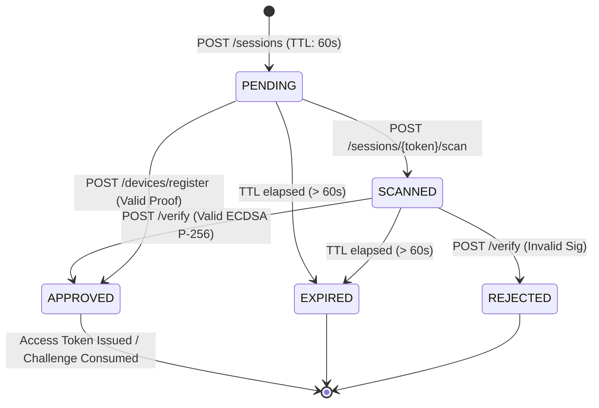

# IPGuard — M2.4 API Contract Specification

**Project:** IPGuard — Secure Digital Asset Protection
**Milestone:** M2.4-B Backend Core Engine & Device Enrollment
**Version:** 1.0.0 (API v1)
**Base URL:** `/api/v1`
**Security Status:** P-256 Hardware Keystore Binding, Strict Origin Whitelisting, Pessimistic Row-Level Lock
**SEC-02 Status:** `COMPLETED (M2.4-C Web QR & M2.4-D Android Integration)`

---

## 1. Cryptographic Wire Protocol & Standards

### 1.1 Public Key Format
- **Format:** X.509 `SubjectPublicKeyInfo` encoded in ASN.1 DER, transmitted as standard RFC 4648 Base64.
- **Algorithm:** Elliptic Curve (EC) Cryptography.
- **Curve:** NIST P-256 (`secp256r1` / `prime256v1`). All other curves (P-384, P-521, secp256k1) and RSA keys are rejected (*fail-closed*).
- **Fingerprint:** SHA-256 digest of raw `SubjectPublicKeyInfo` DER bytes, formatted as 32 uppercase hex pairs separated by colons (95 characters):
  ```text
  ^([0-9A-F]{2}:){31}[0-9A-F]{2}$
  Example: AA:BB:CC:...:11:22
  ```

### 1.2 Signature Format
- **Algorithm:** `SHA256withECDSA` (ECDSA P-256 over SHA-256 digest).
- **Encoding:** ASN.1 DER sequence of two integers `(r, s)` (length 64–72 bytes), transmitted as standard RFC 4648 Base64.
- **Android Reference:** Produced by `java.security.Signature.getInstance("SHA256withECDSA")`.

### 1.3 Canonical Payload Format
Both the Android Authenticator and the FastAPI backend must sign and verify the exact byte sequence of the canonical challenge payload:
```text
f"{session_token}:{nonce}:{origin}:{timestamp}"
```
- `session_token`: 64-character hexadecimal session identifier.
- `nonce`: 64-character hexadecimal cryptographic nonce (256-bit entropy).
- `origin`: RFC 6454 normalized web origin (e.g. `http://localhost:5173`). Must be whitelisted.
- `timestamp`: Integer Unix epoch time in seconds (`int(timestamp)`). **Android clients must use the integer seconds supplied in the QR payload, NOT `System.currentTimeMillis()`**.
- Encoding: UTF-8 byte array (`canonicalPayload.toByteArray(Charsets.UTF_8)`).

---

## 2. API Endpoints

### 2.1 Create Session Challenge
Creates a new authentication or enrollment session with a cryptographically random nonce and a 60-second time-to-live.

- **Method:** `POST`
- **Path:** `/api/v1/auth/sessions`
- **Headers:**
  - `Content-Type: application/json`
  - `Origin: <web_origin>` (optional, validated against trusted origins whitelist)
- **Request Body:**
  ```json
  {
    "session_type": "AUTHENTICATION", // or "ENROLLMENT"
    "origin": "http://localhost:5173"  // optional override, must be in whitelist
  }
  ```
- **Response Status:** `201 Created`
- **Response Body:**
  ```json
  {
    "session_token": "a1b2c3d4...",
    "challenge_nonce": "e5f6a7b8...",
    "session_type": "AUTHENTICATION",
    "status": "PENDING",
    "client_origin": "http://localhost:5173",
    "qr_payload": {
      "version": "1.0",
      "type": "AUTHENTICATION",
      "session_token": "a1b2c3d4...",
      "nonce": "e5f6a7b8...",
      "origin": "http://localhost:5173",
      "timestamp": 1762500000
    },
    "created_at": "2026-11-07T08:00:00Z",
    "expires_at": "2026-11-07T08:01:00Z",
    "poll_interval_ms": 1500,
    "browser_channel_token": "c9d8e7f6a5b4... (256-bit hex, returned ONLY to creating browser)"
  }
  ```
- **Error Codes:**
  - `400 malformed_origin`: Origin URI contains paths, query parameters, fragments, or invalid scheme.
  - `400 untrusted_origin`: Origin is not in the server's configured whitelist.

---

### 2.2 Get Session Status (Polling)
Polls the lifecycle status of an ongoing authentication or enrollment session. Performs lazy expiration evaluation.

- **Method:** `GET`
- **Path:** `/api/v1/auth/sessions/{session_token}`
- **Headers:**
  - `X-Browser-Channel-Token: <token>` (mandatory for sessions with channel protection)
- **Response Status:** `200 OK`
- **Response Body (Pending):**
  ```json
  {
    "session_token": "a1b2c3d4...",
    "session_type": "AUTHENTICATION",
    "status": "PENDING", // PENDING | SCANNED | APPROVED | REJECTED | EXPIRED
    "expires_at": "2026-11-07T08:01:00Z",
    "device": null,
    "access_token": null
  }
  ```
- **Response Body (Approved):**
  ```json
  {
    "session_token": "a1b2c3d4...",
    "session_type": "AUTHENTICATION",
    "status": "APPROVED",
    "expires_at": "2026-11-07T08:01:00Z",
    "device": {
      "device_id": "samsung-a54-01",
      "device_name": "Samsung Galaxy A54 5G",
      "model": "SM-A546B",
      "android_version": "16",
      "public_key_fingerprint": "AA:BB:CC:...:11:22",
      "security_level": "TRUSTED_ENVIRONMENT"
    },
    "access_token": "ipguard_sess_a1b2c3d4..."
  }
  ```
- **Error Codes:**
  - `403 invalid_or_missing_browser_channel_token`: Request header `X-Browser-Channel-Token` is missing, malformed, or fails constant-time hash comparison (Anti QR-Jacking protection).
  - `404 session_not_found`: Session token does not exist.

---

### 2.3 Mark Session Scanned
Signaled by the mobile authenticator when the rear camera successfully detects and decodes the QR code.

- **Method:** `POST`
- **Path:** `/api/v1/auth/sessions/{session_token}/scan`
- **Request Body:**
  ```json
  {
    "device_id": "samsung-a54-01" // optional
  }
  ```
- **Response Status:** `200 OK`
- **Response Body:** Same schema as `SessionStatusResponse` with `"status": "SCANNED"`.
- **Error Codes:**
  - `400 session_expired`: Sesi telah kedaluwarsa (> 60 detik).
  - `400 session_already_approved`: Sesi sudah pernah disetujui sebelumnya.
  - `404 session_not_found`: Sesi tidak ditemukan.

---

### 2.4 Verify Authentication Signature
Validates the ECDSA P-256 signature produced by the enrolled Android authenticator to grant web console access. Enforces pessimistic row-level locking (`SELECT ... FOR UPDATE`) to prevent concurrent consumption.

- **Method:** `POST`
- **Path:** `/api/v1/auth/sessions/{session_token}/verify`
- **Request Body:**
  ```json
  {
    "device_id": "samsung-a54-01",
    "canonical_payload": "a1b2c3d4...:e5f6a7b8...:http://localhost:5173:1762500000",
    "signature": "MEQCIG..." // Base64 ASN.1 DER ECDSA signature
  }
  ```
- **Response Status:** `200 OK`
- **Response Body:** `SessionStatusResponse` with `"status": "APPROVED"` and issued `access_token`.
- **Security Validations:**
  1. `session_token` must exist and be of type `AUTHENTICATION`.
  2. Session must not be expired (`now <= expires_at`).
  3. Sesi tidak boleh berstatus `APPROVED` (anti-replay; concurrent requests receive 400).
  4. Device must exist in database and have status `ACTIVE`.
  5. `canonical_payload` must match byte-for-byte with the server-bound trusted origin and challenge parameters.
  6. ASN.1 DER signature must verify against enrolled public key on NIST P-256 curve.
- **Error Codes:**
  - `400 invalid_session_type`: Session is an ENROLLMENT session.
  - `400 session_expired`: Challenge time-to-live expired.
  - `400 session_already_consumed`: Challenge already used (anti-replay).
  - `400 invalid_canonical_payload`: Tampered challenge string or origin mismatch.
  - `401 invalid_signature`: ECDSA verification failed (wrong key or tampered bytes).
  - `403 device_revoked`: Device status is `REVOKED`.
  - `404 device_not_found`: Device ID is not enrolled.
  - `404 session_not_found`: Session token does not exist.

---

### 2.5 Register / Enroll Device
Binds a new mobile device with its Android Keystore ECDSA P-256 public key. Requires an active `ENROLLMENT` session and proof-of-possession signature.

- **Method:** `POST`
- **Path:** `/api/v1/auth/devices/register`
- **Request Body:**
  ```json
  {
    "session_token": "enroll_token_123...",
    "device_id": "samsung-a54-01",
    "device_name": "Samsung Galaxy A54 5G",
    "model": "SM-A546B",
    "android_version": "16",
    "public_key_x509": "MFkwEwYHKoZIzj0CAQYIKoZIzj0DAQcDQgAE...",
    "security_level": "TRUSTED_ENVIRONMENT",
    "canonical_payload": "enroll_token_123...:nonce...:http://localhost:5173:1762500000",
    "signature": "MEQCIG..."
  }
  ```
- **Response Status:** `201 Created`
- **Response Body:**
  ```json
  {
    "id": "3fa85f64-5717-4562-b3fc-2c963f66afa6",
    "device_id": "samsung-a54-01",
    "device_name": "Samsung Galaxy A54 5G",
    "model": "SM-A546B",
    "android_version": "16",
    "public_key_fingerprint": "AA:BB:CC:...:11:22",
    "security_level": "TRUSTED_ENVIRONMENT",
    "status": "ACTIVE",
    "enrolled_at": "2026-11-07T08:00:00Z",
    "last_used_at": "2026-11-07T08:00:00Z",
    "revoked_at": null
  }
  ```
- **Error Codes:**
  - `400 invalid_session_type`: Session is not an ENROLLMENT session.
  - `400 invalid_public_key_format`: Key is not valid DER Base64.
  - `400 unsupported_curve`: Key is not on curve `secp256r1`.
  - `400 invalid_canonical_payload`: Canonical payload mismatch.
  - `401 signature_verification_failed`: Proof-of-possession signature failed.
  - `404 session_not_found`: Enrollment session does not exist.
  - `409 device_already_registered`: Device ID already active in database.
  - `409 public_key_already_registered`: Public key fingerprint already active in database.

---

### 2.6 Revoke Device
Permanently revokes an enrolled authenticator device, immediately preventing all future sign-in attempts.

- **Method:** `POST`
- **Path:** `/api/v1/auth/devices/{device_id}/revoke`
- **Request Body:**
  ```json
  {
    "reason": "Lost phone" // optional
  }
  ```
- **Response Status:** `200 OK`
- **Response Body:** `DeviceResponse` with `"status": "REVOKED"` and populated `"revoked_at"`. Idempotent if called again on an already revoked device.
- **Error Codes:**
  - `404 device_not_found`: Device ID does not exist.

---

### 2.7 List Enrolled Devices (Development/Test Only)
Administrative inspection endpoint for enrolled devices. Strictly protected by environment check and administrative header.

- **Method:** `GET`
- **Path:** `/api/v1/auth/devices`
- **Headers:**
  - `X-Dev-Admin-Key: <dev_admin_key>` (mandatory)
- **Response Status:** `200 OK`
- **Response Body:** Array of `DeviceResponse` objects.
- **Access Control:**
  - **Production (`APP_ENV=production`):** Strictly returns **HTTP 403 Forbidden** (`endpoint_disabled_in_production`).
  - **Development / Test:** Missing or incorrect key returns **HTTP 401 Unauthorized** (`unauthorized_admin_access`).

---

## 3. Session Lifecycle State Machine



---

## 4. SEC-02 Architecture Boundary (Implemented in M2.4-C & M2.4-D)

> **Status:** `COMPLETED & VERIFIED (M2.4-C Web QR & M2.4-D Android Integration)`

In the current M2.4-B implementation, `session_token` acts as the session reference. In Milestone 2.4-C, full defense against QR-Jacking / Shoulder-Surfing will separate:
1. `qr_session_id`: Public QR display identifier.
2. `challenge_nonce`: Cryptographic nonce signed by Android Keystore.
3. `browser_channel_token`: Secret credential returned exclusively to the initiating browser in JSON response, never displayed in the QR code. Status polling will require this secret to retrieve `access_token`.
