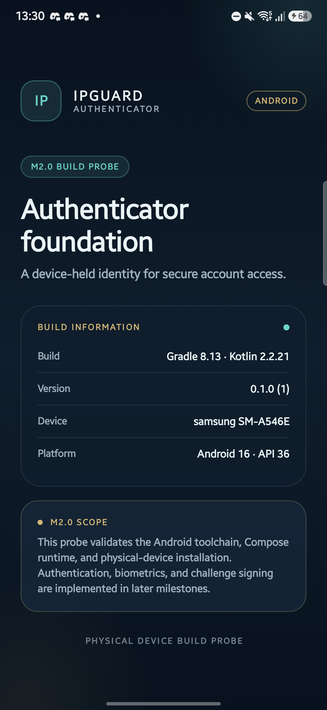

# M2 Environment Report

**Project:** IPGuard — Secure Digital Asset Protection  
**Milestone:** M2.0 — Android Environment and Build Foundation  
**Date:** 2026-11-06  
**Status:** M2.0 COMPLETED ON PHYSICAL DEVICE  
**Overall M2 status:** IN PROGRESS — M2.1 verified; M2.2 has not started

> This report remains the historical M2.0 environment and build-probe evidence. Current M2.1 application, navigation, and physical-device evidence is recorded in [M2_TEST_REPORT.md](M2_TEST_REPORT.md).

---

## 1. Result Summary

| Area | Result | Evidence |
|---|---|---|
| Android SDK and Build Tools | **PASS** | API 36 rev 2, Build Tools 36.0.0 pinned, Platform Tools 37.0.1 |
| Compatible JDK | **PASS** | Temurin 17.0.20.1 used by Gradle |
| Gradle Wrapper | **PASS** | Gradle 8.13, checksum-pinned |
| Android build | **PASS** | `:app:assembleDebug` succeeded |
| Lint | **PASS** | 0 errors, 4 informational warnings |
| APK packaging | **PASS** | `com.ipguard.authenticator` 0.1.0 (1), minSdk 28, targetSdk 36 |
| APK signature verification | **PASS** | APK Signature Scheme v2, Android Debug certificate |
| Installation on physical device | **PASS** | `adb install -r`: Success |
| Foreground launch | **PASS** | MainActivity focused; cold launch 873 ms |
| Runtime stability check | **PASS** | Process alive after 6 seconds; no fatal exception |
| UI verification | **PASS** | Expected Compose content observed on 1080 × 2340 device |
| Authentication behavior | **NOT TESTED** | M2.0 contains no authentication feature |
| Keystore/biometric/camera/QR behavior | **NOT TESTED** | M2.2–M2.4 scope |
| Android Studio/emulator | **NOT INSTALLED** | CLI toolchain and physical device used |

M2.0 is complete. The environment is ready for M2.1 application development, subject to the recorded limitations.

---

## 2. Host and Disk

| Item | Value |
|---|---|
| Operating system | Windows 11 Home Single Language, build 22621, 64-bit |
| PowerShell | 5.1.22621.4249 |
| Project path | `C:\Users\user\Documents\02_Projects\IPGuard` |
| Physical project path | `D:\Data\Documents\02_Projects\IPGuard` through the Documents junction |
| Python / Node / PostgreSQL | Unchanged from M1; not required for M2.0 |

Disk at final M2.0 verification:

| Drive | Free | Used |
|---|---:|---:|
| C: | 3.09 GB | 122.01 GB |
| D: | 57.24 GB | 193.35 GB |

C: free space is low and must remain a monitored constraint. Android SDK, JDK, Gradle, and project caches are on D:.

Verified project cache locations:

```text
D:\Android\.gradle        about 1.17 GB
D:\Android\Sdk
D:\Android\jdk-17
D:\Android\gradle-8.13
```

A pre-existing user Gradle cache on C: was not used for this build. No project build cache was intentionally placed on C:.

---

## 3. Toolchain Versions

| Tool | Version / status |
|---|---|
| Java | Eclipse Temurin 17.0.20.1+1 |
| `javac` | 17.0.20.1 |
| Gradle Wrapper | 8.13 |
| Android Gradle Plugin | 8.13.2 |
| Kotlin plugin | 2.2.21 |
| Compose BOM | 2025.12.01 |
| Android SDK Platform | API 36, revision 2 |
| Android SDK Build Tools | 36.0.0 pinned; 35.0.0 also installed by tooling |
| AAPT2 | AGP-provided `aapt2-8.13.2-14304508-windows` |
| Android SDK Platform Tools | 37.0.1 |
| ADB | 1.0.41 |
| Android SDK Command-line Tools | 22.0, build 15859902 |
| `aapt` | v0.2-13193326 |
| `apksigner` | 0.9 |
| Android Studio | Not installed |
| Android emulator / AVD | Not installed |

### Global Java note

The machine's global Java remains version 22. Android commands must be run after loading `scripts\android-env.ps1`, which sets `JAVA_HOME` and PATH for the current process to JDK 17.

### Build Tools note

Build Tools 36.0.0 was explicitly installed and is pinned in `app/build.gradle.kts`. Build Tools 35.0.0 appeared at `2026-11-06 13:00` during early Android tooling/dependency resolution. It is not selected by the project configuration. Both are recorded so the SDK inventory remains accurate.

### Command-line tools note

`sdkmanager` reports that it is deprecated and points to a newer Android CLI. It completed all required operations successfully, including license acceptance and package installation. Migration to the new CLI is not required for M2.0.

---

## 4. Installation Provenance

| Artifact | Bytes | SHA-256 |
|---|---:|---|
| `OpenJDK17U-jdk_x64_windows_hotspot_17.0.20.1_1.zip` | 190,817,615 | `E53A79C3C3D86865BD7E787903884331068E71321714FFD44F145785AFFC7CB0` |
| `commandlinetools-win-15859902_latest.zip` | 155,655,386 | `90AE805D20434428BFFCB699C290860F19BB5F66A67E6B330067E3DE801FB04A` |
| `gradle-8.13-bin.zip` | 136,983,045 | `20F1B1176237254A6FC204D8434196FA11A4CFB387567519C61556E8710AED78` |

The Gradle ZIP checksum matches the value published by `services.gradle.org`. The Gradle Wrapper also embeds this checksum.

Installation is local to D:. No Windows service, registry entry, system-wide `JAVA_HOME`, or global Android SDK variable was created.

---

## 5. Android SDK Inventory

Installed packages reported by `sdkmanager --list_installed`:

```text
build-tools;35.0.0     35.0.0
build-tools;36.0.0     36.0.0
platform-tools         37.0.1
platforms;android-36   2
```

Android SDK licenses were reviewed and accepted locally through:

```powershell
sdkmanager --licenses
```

The command completed with exit code 0. License acceptance applies to this local SDK installation.

No emulator package, system image, Android Studio bundle, or AVD was installed.

---

## 6. Physical Device

| Item | Value |
|---|---|
| Manufacturer | Samsung |
| Model | SM-A546E |
| OS | Android 16 |
| API level | 36 |
| ABI | arm64-v8a (device); package also contains 32-bit and x86 native entries |
| Display | 1080 × 2340 physical pixels, density 450 |
| Security patch | 2026-05-05 |
| System build type | `user` |
| Build tags | `release-keys` |
| `ro.debuggable` | 0 |
| SoC reported by Android | `s5e8835` |
| ADB transport state | `device` |

The device serial number is deliberately omitted from this document and from all project documentation.

Platform feature declarations observed on the device:

```text
android.hardware.biometrics.face
android.hardware.fingerprint
android.hardware.hardware_keystore=200
android.hardware.keystore.app_attest_key
android.software.secure_lock_screen
android.hardware.camera.any
android.hardware.camera.front
```

These declarations do **not** prove Class 3 biometric strength, hardware-backed key generation, StrongBox, attestation, or successful challenge signing. Those checks belong to M2.2–M2.4.

---

## 7. Build Verification

Commands executed from:

```text
C:\Users\user\Documents\02_Projects\IPGuard\mobile-authenticator
```

Environment:

```powershell
. ..\scripts\android-env.ps1
.\gradlew.bat :app:assembleDebug
.\gradlew.bat :app:lintDebug
```

Result:

```text
BUILD SUCCESSFUL
0 errors, 4 warnings
```

Final debug APK:

| Item | Value |
|---|---|
| Path | `mobile-authenticator\app\build\outputs\apk\debug\app-debug.apk` |
| Size | 29,469,904 bytes |
| SHA-256 | `C06D20577D13D04AC6812330D04381F4EDF6CC046CF1187265DE73E3F28A723F` |
| Package | `com.ipguard.authenticator` |
| Version | `0.1.0` (`versionCode 1`) |
| Minimum SDK | 28 |
| Target SDK | 36 |
| Compile SDK | 36 |
| Launchable activity | `com.ipguard.authenticator.MainActivity` |

### Signature

`apksigner verify` result:

```text
Verified using v2 scheme (APK Signature Scheme v2): true
v1: false
v3: false
v3.1: false
v4: false
Signer #1 certificate DN: C=US, O=Android, CN=Android Debug
```

This is a debug-signed artifact. It is not a production release and must not be distributed.

### Lint warnings

The four warnings are informational:

1. Gradle 8.14.6 is available; the project intentionally uses checksum-pinned 8.13 for the M2.0 foundation.
2. `androidx.core:core-ktx` 1.19.1 is available; 1.17.0 is used in the current compatibility set.
3. `androidx.activity:activity-compose` 1.13.0 is available; 1.11.0 is used in the current compatibility set.
4. Lint reports the `mipmap-anydpi-v28` folder as unnecessary because minSdk is 28. Moving the adaptive icon to unversioned `mipmap-anydpi` caused AAPT resource linking to fail, so the versioned adaptive-icon folder is intentionally retained.

No lint warning is an error or an unrecorded failure.

---

## 8. Installation and Launch Verification

Installation:

```text
Performing Streamed Install
Success
```

Cold launch measurement:

```text
LaunchState: COLD
Status: ok
TotalTime: 873 ms
WaitTime: 876 ms
Activity: com.ipguard.authenticator/.MainActivity
```

Foreground checks:

```text
mCurrentFocus=... com.ipguard.authenticator/com.ipguard.authenticator.MainActivity
mFocusedApp=... com.ipguard.authenticator/.MainActivity
```

The application process was still running after a six-second observation window. The app-specific log contained no `FATAL EXCEPTION` or `AndroidRuntime` crash entry. Platform-level messages such as `E/ashmem` and `E/VibratorInfo` were emitted by the OS/HAL and are not application crashes.

---

## 9. UI Verification

The Compose UI was captured after the activity was focused in the foreground:



| Item | Value |
|---|---|
| Screenshot | `docs/assets/m2.0-build-probe.png` |
| Screenshot size | 360,442 bytes |
| Screenshot SHA-256 | `F907BFC36F06A9B641EA8706D08A0500B58B37BD83EB030CFFA2BC2AB302DEE6` |
| Resolution | 1080 × 2340 |
| Density | 450 dpi |

The accessibility hierarchy confirmed these visible texts:

```text
IPGUARD
AUTHENTICATOR
M2.0 BUILD PROBE
Authenticator foundation
BUILD INFORMATION
Gradle 8.13 · Kotlin 2.2.21
0.1.0 (1)
samsung SM-A546E
Android 16 · API 36
M2.0 SCOPE
PHYSICAL DEVICE BUILD PROBE
```

The build probe visibly states that authentication, biometrics, and challenge signing are implemented in later milestones.

---

## 10. Security and Privacy Checks

| Check | Result |
|---|---|
| Device-bound authentication implemented | No — M2.1+ scope |
| Secrets added | No |
| Real credentials exposed | No |
| Device serial in documentation | No — redacted/omitted |
| Cleartext traffic enabled | No — `usesCleartextTraffic="false"` |
| Application backup enabled | No |
| Device-transfer extraction enabled | No |
| APK release-signed | No — debug only |
| Global environment modified | No — session-local script only |
| Services or registry entries created | No |

The debug application declares `INTERNET`, `CAMERA`, and `USE_BIOMETRIC` for later milestones. No runtime permission was requested or exercised in M2.0.

---

## 11. Incidents and Limitations

| ID | Observation | Impact / handling |
|---|---|---|
| M2-ENV-01 | First dependency resolution failed with transient `UnknownHostException` for Maven Central | Retry succeeded; no dependency version was changed |
| M2-ENV-02 | One Gradle startup failed with loopback `java.net.BindException` | Daemons stopped; subsequent build succeeded |
| M2-ENV-03 | C: free space is 3.09 GB | All Android tooling/caches are kept on D:; space remains a monitor item |
| M2-ENV-04 | Android Studio, emulator, and AVDs are absent | Physical-device testing is mandatory; command-line build is sufficient for M2.0 |
| M2-ENV-05 | Debug APK only | Production signing and release hardening remain out of scope |
| M2-ENV-06 | Four lint warnings remain | Informational; versions will be revisited in M2.1 through M2.4 dependency work |
| M2-ENV-07 | Build Tools 35.0.0 was auto-added to the SDK | Recorded; project pins 36.0.0 |
| M2-ENV-08 | No authentication, crypto, biometric, QR, or camera behavior exists yet | Not a failure; explicitly untested and deferred |

---

## 12. M2.0 Acceptance

| Requirement | Result |
|---|---|
| Android build toolchain available | PASS |
| Compatible JDK selected per build | PASS |
| Gradle Wrapper exists and builds | PASS |
| Minimal APK can be built | PASS |
| APK installs on connected physical device | PASS |
| APK runs in foreground | PASS |
| Setup and environment documentation produced | PASS |

M2.0 is complete.

M2.1 has since been implemented and verified on the physical device as an interface foundation only. See [M2_ARCHITECTURE.md](M2_ARCHITECTURE.md) and [M2_TEST_REPORT.md](M2_TEST_REPORT.md). M2.2 is the next permitted step; device-bound security must not be claimed until the M2.3/M2.4 cryptographic and physical verification gates pass.
