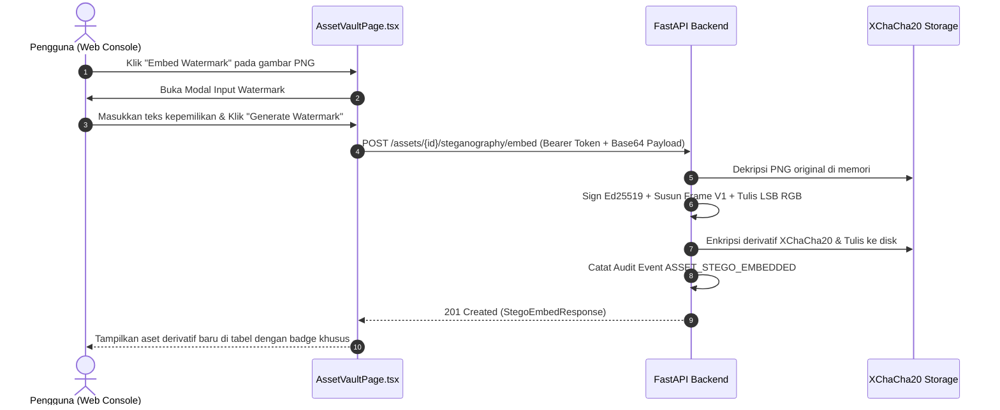

# M4 Frontend Specification — Steganography Web Console

**Document Version:** 1.0.0  
**Target Milestone:** Milestone 4 (M4) — Steganographic Watermarking & Asset Integrity  
**Component Target:** `frontend/src/pages/assets/AssetVaultPage.tsx`, `frontend/src/services/assets.ts`, `frontend/src/types/assets.ts`  
**Status:** Architecture & UI/UX Specification  

---

## 1. Overview & User Experience Goals

Fitur Steganografi M4 menambahkan kapabilitas penandaan hak cipta digital (*digital watermarking*) dan pembuktian integritas/orisinilitas aset gambar PNG langsung dari Web Console IPGuard.

Antarmuka harus menyediakan:
1. Kemudahan menyematkan pesan rahasia / bukti kepemilikan ke dalam gambar PNG yang tersimpan di vault.
2. Informasi kapasitas penyisipan LSB secara real-time berdasarkan resolusi gambar.
3. Visualisasi relasi antara aset original dan aset turunan (*derivatives*).
4. Mekanisme verifikasi instan satu-klik untuk membuktikan keaslian tanda tangan digital **Ed25519**.
5. Kemampuan mengekstrak payload rahasia hanya jika tanda tangan digital terbukti sah.

---

## 2. API Contract & Service Layer

### 2.1 Tipe Data Baru (`frontend/src/types/assets.ts`)

```typescript
export interface Asset {
  id: string
  original_filename: string
  content_type: string | null
  size_bytes: number
  sha256_hash: string
  encryption_version: string
  // Field tambahan Milestone 4:
  source_asset_id?: string | null
  derivative_type?: string | null
  watermark_id?: string | null
  stego_format_version?: number | null
  created_at: string
  updated_at: string
  encryption_status: string
}

export interface StegoEmbedRequest {
  payload_b64: string
}

export interface StegoEmbedResponse {
  derivative: Asset
  watermark_id: string
  format_version: number
}

export interface WatermarkVerifyResponse {
  verified: bool
  status: string
  watermark_id: string | null
  source_asset_id: string | null
  derivative_asset_id: string | null
  format_version: number | null
}

export interface WatermarkExtractResponse extends WatermarkVerifyResponse {
  payload_b64: string
}
```

### 2.2 Fungsi Service Baru (`frontend/src/services/assets.ts`)

```typescript
export async function embedWatermark(
  token: string,
  assetId: string,
  payloadText: string,
): Promise<StegoEmbedResponse> {
  const payload_b64 = btoa(unescape(encodeURIComponent(payloadText)))
  const response = await apiClient.post<StegoEmbedResponse>(
    `/assets/${assetId}/steganography/embed`,
    { payload_b64 },
    { headers: authHeaders(token) }
  )
  return response.data
}

export async function verifyWatermark(
  token: string,
  assetId: string,
): Promise<WatermarkVerifyResponse> {
  const response = await apiClient.post<WatermarkVerifyResponse>(
    `/assets/${assetId}/steganography/verify`,
    {},
    { headers: authHeaders(token) }
  )
  return response.data
}

export async function extractWatermark(
  token: string,
  assetId: string,
): Promise<WatermarkExtractResponse> {
  const response = await apiClient.post<WatermarkExtractResponse>(
    `/assets/${assetId}/steganography/extract`,
    {},
    { headers: authHeaders(token) }
  )
  return response.data
}
```

---

## 3. UI/UX Component Specifications

### 3.1 Badge Relasi Derivatif pada Tabel Aset
Pada tabel daftar aset di `AssetVaultPage.tsx`:
- Jika aset memiliki `derivative_type === "PNG_LSB"`, tampilkan badge ungu:  
  `<span className="px-2 py-0.5 rounded text-xs bg-purple-900/40 text-purple-300 border border-purple-700/50">Watermarked Derivative</span>`
- Tampilkan indikator link yang merujuk ke aset induk (`source_asset_id`).

### 3.2 Modal Embed Watermark
Modal interaktif yang dipicu saat mengklik ikon *Stamp/Watermark* pada baris aset PNG:
- **Kondisi Aktif:** Hanya muncul untuk file bertipe `image/png` dan bukan aset derivatif (`source_asset_id == null`).
- **Input Textarea:** Tempat pengguna mengetik teks bukti kepemilikan (misal: `"Hak Cipta © 2026 PT IPGuard Solusi Digital - ID: USR-88492"`).
- **Kapasitas Counter:** Menampilkan visualisasi kapasitas yang digunakan vs kapasitas maksimum gambar:
  $$\text{Kapasitas LSB} \approx \frac{\text{Lebar} \times \text{Tinggi} \times 3}{8} - 170 \text{ bytes}$$
- **Proteksi Error:** Mencegah submit jika payload melebihi batas atau kosong.
- **Loading State:** Animasi pemrosesan (download $\rightarrow$ embed LSB $\rightarrow$ sign Ed25519 $\rightarrow$ encrypt XChaCha20).

### 3.3 Modal Verifikasi & Ekstraksi Watermark
Modal hasil verifikasi yang dipicu dari aset derivatif:
- **Card Status Kriptografis:**
  - Jika `verified: true`: Banner hijau bertuliskan **"Authentic Watermark Verified"** dengan rincian Watermark UUID, Derivative ID, Source ID, dan Algoritma Ed25519.
  - Jika `verified: false`: Banner merah **"Tampered or Invalid Watermark"** dengan kode error (misal: `INVALID_SIGNATURE`, `CHECKSUM_MISMATCH`).
- **Panel Payload Terdekripsi:**
  Menampilkan isi teks watermark yang berhasil diekstrak dan tombol *Copy to Clipboard*.

---

## 4. Alur Interaksi Pengguna (User Interaction Flow)


