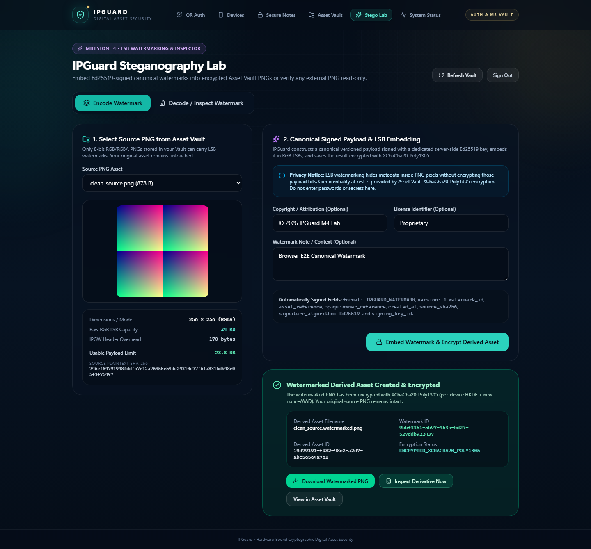
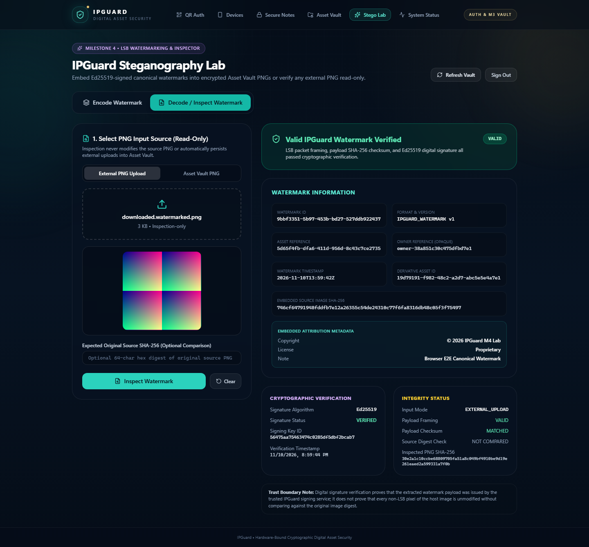
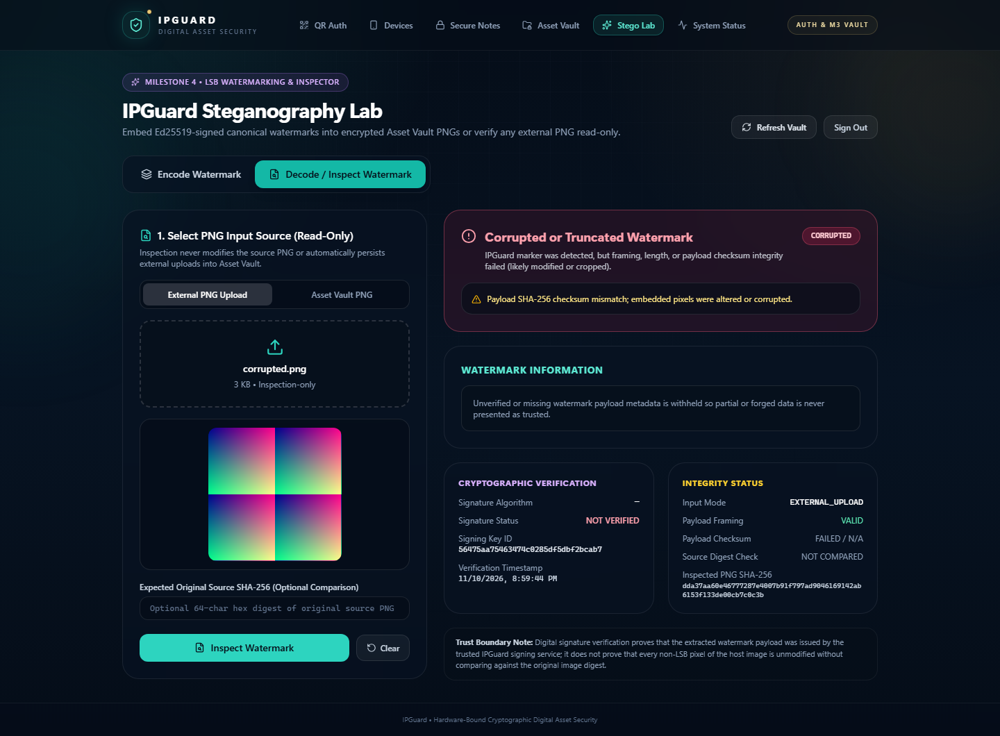
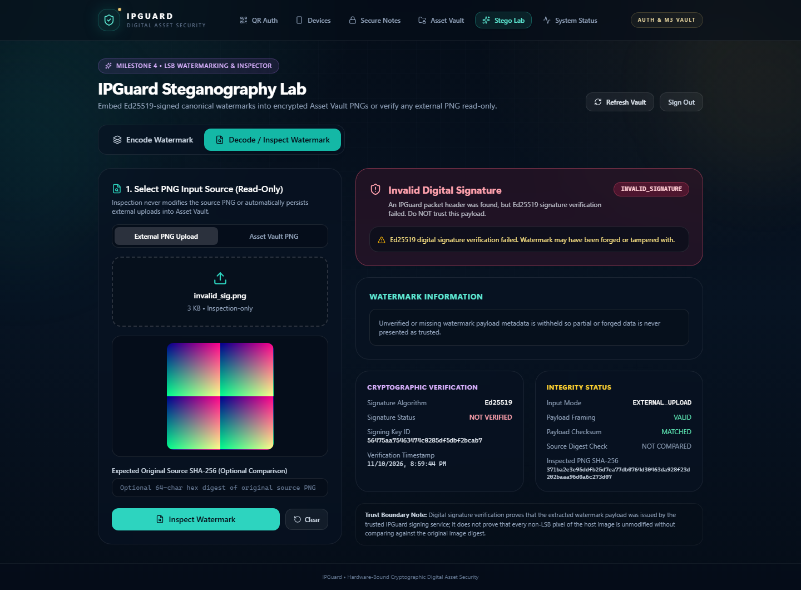

# IPGuard M4 — Steganography Test & Verification Report

**Test Date:** 2026-11-10  
**Branch:** `feature/m4-steganography`  
**Database:** PostgreSQL 17.11 (`0009_png_lsb_derivatives` head)

---

## 1. Automated Backend Test Suite

- **Full Suite Execution (`python -m pytest -q`):** **213 Passed, 1 Skipped (Postgres-specific env flag check), 0 Failed**
- **New Dedicated Test File (`backend/tests/test_steganography_lab.py`):** **5/5 Comprehensive Suites PASSED** against PostgreSQL 17.11.

### Coverage Breakdown

| Category | Verified Scenarios | Result |
|---|---|---|
| **Payload & Privacy** | Canonical sorted JSON (`IPGUARD_WATERMARK` v1), opaque `owner_reference`, raw `device_id` omitted, control chars stripped | **PASS** |
| **LSB Engine & Capacity** | Exact `(W*H*3)//8 - 170` usable bytes, RGBA alpha channel byte-for-byte preservation, dimensions unchanged | **PASS** |
| **Signature & Key Lifecycle** | Valid Ed25519 signature (`VALID`), offline verification (public key only), rotated key lookup, `UNKNOWN_SIGNER`, `INVALID_SIGNATURE` | **PASS** |
| **Tampering & Corruption** | Header magic missing (`NO_WATERMARK`), version mismatch (`UNSUPPORTED_VERSION`), payload pixel flip (`CORRUPTED`), signature bit flip (`INVALID_SIGNATURE`) | **PASS** |
| **Asset Integration & Isolation** | Cross-device access blocked (`404`), original SHA-256 unchanged, ciphertext lacks plaintext PNG header, derived asset downloadable & inspectable, delete derivative preserves original | **PASS** |
| **External Inspector Guard** | Unauthenticated rejected (`401`), zero DB/disk persistence verified before/after upload | **PASS** |

---

## 2. Synthetic Image Transformation Robustness Results

Tested via `test_synthetic_image_transformations` in `backend/tests/test_steganography_lab.py`:

| Transformation | Output Status | Observed Behavior |
|---|---|---|
| **PNG Lossless Re-save (`compress_level=9`)** | `VALID` | zlib compression preserves decoded RGB pixel LSBs 100%. Watermark verified. |
| **Resize (`220x220` &rarr; `180x180`)** | `NO_WATERMARK` / `CORRUPTED` | Pixel interpolation alters LSB values; watermark destroyed as expected for spatial-domain LSB. |
| **Crop (`(10, 10, 200, 200)`)** | `NO_WATERMARK` / `CORRUPTED` | Shifts row-major pixel alignment and truncates header; watermark destroyed. |
| **Lossy JPEG Conversion (`quality=95`) &rarr; PNG** | `NO_WATERMARK` / `CORRUPTED` | DCT quantization modifies least-significant RGB bits; watermark destroyed. |

---

## 3. Frontend TypeScript & Build Verification

```text
> npm run typecheck  -> tsc --noEmit (0 errors)
> npm run build      -> vite build: 2,199 modules transformed, built in 699ms
```

---

## 4. Browser End-to-End Verification (`/steganography`)

Executed via headless Chromium Playwright against live FastAPI (`:8000`), PostgreSQL 17 (`:5432`), and Vite (`:5173`) with all synthetic test rows & storage files cleaned up after verification.

### Verified E2E Scenarios
1. **Unauthenticated Access Guard:** `/steganography` displays lock screen until M2 Bearer session is established (`01_stego_locked.png`).
2. **Encode Watermark & Save Derived Encrypted Asset:** Selected `clean_source.png` (`256×256 RGBA`), rendered `23.8 KB` usable payload capacity, embedded `© 2026 IPGuard M4 Lab` attribution, persisted `clean_source.watermarked.png` encrypted via XChaCha20-Poly1305 (`02_stego_encode_success.png`).
3. **Asset Vault Derivative Inspection (`ASSET_VAULT`):** Clicked **Inspect Derivative Now**, verified `VALID` status, Ed25519 signature verification, and matched `source_digest_matches` (`03_stego_inspect_vault_valid.png`).
4. **External Upload Inspection (`EXTERNAL_UPLOAD` — `VALID`):** Uploaded downloaded watermarked PNG without persisting to Vault, verified `VALID` banner and full metadata (`04_stego_inspect_external_valid.png`).
5. **External Upload Inspection (`CORRUPTED`):** Flipped payload RGB LSB bit, verified `CORRUPTED` status banner with payload SHA-256 checksum warning and untrusted metadata withheld (`05_stego_inspect_corrupted.png`).
6. **External Upload Inspection (`INVALID_SIGNATURE`):** Flipped Ed25519 signature bit, verified `INVALID_SIGNATURE` banner with untrusted metadata withheld (`06_stego_inspect_invalid_sig.png`).
7. **External Upload Inspection (`NO_WATERMARK`):** Uploaded clean PNG, verified `NO_WATERMARK` status (`07_stego_inspect_no_watermark.png`).

### Demonstration Screenshots

#### 1. Watermark Encoding & Encrypted Derived Asset Creation


#### 2. External PNG Inspection — Valid Watermark (`VALID`)


#### 3. External PNG Inspection — Corrupted Payload (`CORRUPTED`)


#### 4. External PNG Inspection — Invalid Signature (`INVALID_SIGNATURE`)

