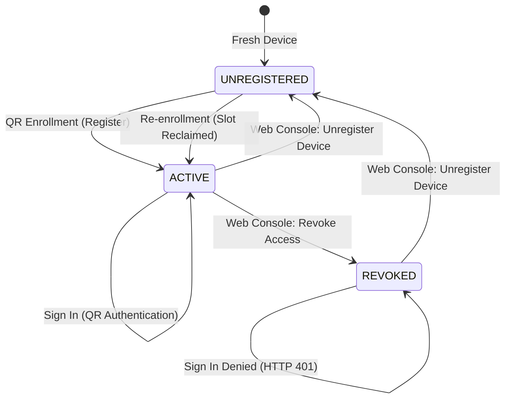

# IPGuard One-Time Device Enrollment & Sign-In Only Architecture

- **Project:** IPGuard (Secure Digital Asset Protection)
- **Milestone:** M2 Hardening & Lifecycle Refinement
- **Branch:** `feature/m2-one-time-device-enrollment`
- **Base Branch:** `feature/m2.4d-android-integration`
- **Status:** Complete & Verified
- **Verdict:** `READY FOR REVIEW`

---

## 1. Executive Summary

This deliverable establishes the permanent lifecycle contract for IPGuard authenticators:
> **A device is registered once. After successful registration, it can only sign in.**

Under this architectural model, an Android smartphone acts as a **hardware security authenticator** holding an immutable ECDSA P-256 signing key in Android Keystore backed by hardware security (`KeyProperties.SECURITY_LEVEL_TRUSTED_ENVIRONMENT` / StrongBox). Once enrolled, the device transitions to `ACTIVE` status and is permanently locked to "Sign In" mode. Scanning an enrollment QR code is rejected both client-side and server-side (HTTP 409 `DEVICE_ALREADY_REGISTERED`). Re-enrollment is only permissible after an explicit administrative `Unregister Device` action executed from the Web Console, which cleanly releases the binding without deleting notes or orphan records.

---

## 2. Architecture: Previous vs New Flow

```mermaid
flowchart TD
    subgraph Previous Flow (Vulnerable to Key Overwrite)
        P1[Fresh App / Missing Key] --> P2[Scan Any QR]
        P2 --> P3{QR Type?}
        P3 -- Enrollment --> P4[Generate P-256 Key & Register]
        P3 -- Auth --> P5[Sign Challenge]
        P4 --> P6[Registered Device]
        P6 -. User clicks Setup Device again .-> P7[Silent Key Overwrite / Orphan Key]
        P7 -. Broken Sign-In .-> P8[Failure State]
    end

    subgraph New Flow (Hardware Authenticator Lifecycle)
        N1[Fresh Install: UNREGISTERED] --> N2[Show: 'Set up this device']
        N2 --> N3[Scan QR ENROLLMENT]
        N3 --> N4[Generate Hardware Key + Biometric Approval]
        N4 --> N5[Backend Registration: Status ACTIVE]
        N5 --> N6[Persistent State: ACTIVE]
        N6 --> N7[UI Switches to Sign-In Only: 'Sign In (Scan QR)']
        N6 -. Hide / Block 'Set up this device' .-> N8[Setup Blocked]
        N7 --> N9[Scan QR AUTHENTICATION]
        N9 --> N10[Sign Challenge with Existing Keystore Key]
        N10 --> N11[Web Session Approved]
        N6 -. Accidental QR Enrollment Scan .-> N12[Rejected: DEVICE_ALREADY_REGISTERED (409)]
        N6 -. Web Console: Unregister Device .-> N13[Status: UNREGISTERED & Release Slot]
        N13 --> N1
    end
```

### Detailed Lifecycle Comparison

| Aspect | Previous Implementation | New Refined Implementation |
| :--- | :--- | :--- |
| **Device Initial State** | Unenrolled, no state persistence | `UNREGISTERED` tracked in SharedPreferences & Backend |
| **Welcome Screen UI** | Always displays "Set up this device" button | Dynamically switches between Setup (`UNREGISTERED`) and "Sign In (Scan QR)" (`ACTIVE`) |
| **Key Generation Policy** | Could overwrite existing Keystore keys | `ensureSigningKey` on enrollment only; throws `SigningKeyPolicyViolationException` if registered |
| **Accidental Re-enrollment** | Backend returned duplicate or error | Client rejects scan upfront; Backend returns HTTP 409 `DEVICE_ALREADY_REGISTERED` with pessimistic row locking |
| **Sign-In Missing Key** | Potential auto-generation attempt | Fails closed immediately without generating replacement key |
| **Revoke Access** | Cleared credentials | Sets `status = REVOKED`, kills active sessions, but **retains registration slot** (cannot re-enroll without unregister) |
| **Unregister Device** | Not implemented (hard-delete risk) | Sets `unregistered_at`, status `UNREGISTERED`, invalidates sessions, releases registration lock, preserves notes |
| **M3 Secure Notes Impact** | Risk of losing `device_id` (`owner_id`) | `device_id` is preserved; re-enrollment re-activates existing identity; notes remain intact |

---

## 3. State Model: Registration vs Access Status

The backend decouples **Registration Lifecycle** from **Session Access State**:



### State Fields Definition

1. **`registration_status`**:
   - `ACTIVE`: Device is enrolled as an active authenticator. Registration slot is occupied. Re-enrollment rejected with HTTP 409.
   - `REVOKED`: Device access was cut off by admin. Registration slot remains occupied to prevent unauthorized re-binding.
   - `UNREGISTERED`: Binding terminated via Web Console (`unregistered_at != None`). Registration slot is open for fresh enrollment.

2. **`access_status`**:
   - `GRANTED`: Device status is `ACTIVE` and `unregistered_at is None`. Can authenticate sessions and sign notes.
   - `REVOKED`: Device status is `REVOKED` or `unregistered_at is not None`. Cannot authenticate.

---

## 4. Backend Enforcement & Database Protection

### 4.1. Database Schema & Migration 0005

- **Model:** `backend/app/models/auth.py`
  - Added column: `unregistered_at: Mapped[datetime | None] = mapped_column(DateTime(timezone=True), nullable=True)`
- **Migration:** `backend/app/db/migrations/versions/0005_device_unregistered_status.py`
  - Revises: `0004_secure_notes`
  - Adds `unregistered_at` timestamp column to `devices` table without destroying existing indexes or tables.
  - Head status: Clean single head at `0005_device_unregistered_status (head)`.

### 4.2. Registration Concurrency & Anti-Collision (Pessimistic Locking)

In `backend/app/services/auth.py`:
- `register_device` applies pessimistic row-level locking:
  ```python
  existing_device = db.query(Device).filter(Device.device_id == request.deviceId).with_for_update().first()
  ```
- **Conflict Evaluation:**
  - If a device or public key fingerprint exists with `status == "ACTIVE"` or `"REVOKED"` and `unregistered_at is None`:
    - Rejects request with **HTTP 409 Conflict**:
      `detail="DEVICE_ALREADY_REGISTERED: Device or signing key is already registered. To re-register, unregister the device first from the console."`
  - If device was previously `UNREGISTERED`:
    - Re-activates existing `Device` record (`status = "ACTIVE"`, `unregistered_at = None`, updates `public_key_x509` and device metadata).
    - Preserves `device_id` as foreign key reference, ensuring M3 `Note` records never become orphaned!

### 4.3. Session Invalidation on Device Revocation and Unregistration

- When `revoke_device(device_id)` or `unregister_device(device_id)` is invoked:
  - Updates all active `Session` rows for the device:
    `session.status = SessionStatus.REVOKED` or `EXPIRED`.
  - Terminates all in-flight web sessions immediately.

### 4.4. Dedicated Endpoints

- `GET /api/v1/auth/devices/{device_id}/status`:
  - Returns device lifecycle status (`registration_status`, `access_status`, `public_key_fingerprint`).
  - Used by mobile authenticator on launch to detect backend unregistration.
- `POST /api/v1/auth/devices/{device_id}/unregister`:
  - Admin/Bearer authenticated endpoint to release device binding (`unregistered_at = now`).
- `POST /api/v1/auth/devices/{device_id}/revoke`:
  - Revokes access without releasing registration slot.

---

## 5. Android Authenticator Implementation

### 5.1. `DeviceRegistrationManager.kt`
- Implements persistent enrollment state in Android Authenticator using SharedPreferences (`ipguard_device_registration`).
- Tracks `DeviceRegistrationStatus` (`UNREGISTERED`, `ACTIVE`, `REVOKED`) and public key fingerprint.
- Exposes `isRegistered()`, `setRegistrationStatus()`, `clearRegistration()`.

### 5.2. `AuthenticatorViewModel.kt`
- **Initialization & Background Sync:**
  - On launch, calls `syncRegistrationWithBackend()`.
  - Queries `GET /devices/{device_id}/status`. If backend reports `UNREGISTERED`, local state clears to `UNREGISTERED`.
- **Pre-Scan Guard in `onQrCodeScanned`:**
  - When scanning `QrSessionType.ENROLLMENT` while `registrationManager.isRegistered()`:
    - Rejects scan immediately:
      `"Device Already Registered. This device is already linked to IPGuard. Please use Sign In."`
    - Does not proceed to approval screen.
- **Fail-Closed Execution in `approveAndExecuteAuth`:**
  - For `QrSessionType.ENROLLMENT`:
    - Verifies `!registrationManager.isRegistered()`.
    - If registered, aborts with error message.
    - If fresh, invokes `ensureSigningKey(requireUserAuthentication = true)` and submits public key to backend.
    - On HTTP 409 conflict: sets local state to `ACTIVE` and halts.
  - For `QrSessionType.AUTHENTICATION`:
    - If `!keyManager.hasSigningKey()`, fails closed immediately with:
      `"Device signing key is not initialized in Keystore. Please contact administrator to unregister this device if the key was lost."`
    - Never auto-generates a key during authentication.
- **Key Protection:**
  - `generateSigningKey()`, `regenerateSigningKey()`, and `deleteSigningKey()` throw `SigningKeyPolicyViolationException` when `registrationManager.isRegistered()`.

### 5.3. UI Adaptations: `WelcomeScreen.kt` & `AppNavHost.kt`
- When `uiState.isRegistered == false`:
  - Displays original welcome screen: "Your phone is the key."
  - Primary button: "Set up this device" -> routes to registration flow.
- When `uiState.isRegistered == true`:
  - Displays registered welcome screen: "Trusted Authenticator Active"
  - Primary button: "Sign In (Scan QR)" -> routes directly to QR scanner.
  - Hides "Set up this device" button completely.
  - If key is missing from Keystore while registered, displays a prominent Warning Notice directing user to the Web Console unregister flow.
- In `AppNavHost.kt`:
  - `Registration.route` contains a navigation guard: if `uiState.isRegistered`, automatically pops back to Home.

---

## 6. Frontend Web Device Management Console

A complete Web Device Management Console was created to manage device lifecycles:

- **Location:** `frontend/src/pages/devices/DeviceManagementPage.tsx`
- **Routing:** `/devices` via `frontend/src/app/router.tsx` and Navigation Menu link in `AppShell.tsx`.
- **Key Features:**
  - **Metrics Row:** Total Registered Devices, Active Hardware Authenticators, Revoked Devices, Security Standard (FIPS 186-4 ECDSA P-256).
  - **Device List & Status Chips:** Visual status chips (`Enrolled & Active`, `Access Revoked`, `Unregistered`).
  - **Revoke Access Dialog:** Modal to cut off device access while keeping registration slot locked.
  - **Unregister Device Dialog:** Modal with security warning explaining that unregistering releases the device binding and permits fresh enrollment.
  - **M3 Secure Notes Notice:** Clarifies that unregistering does not delete encrypted notes.

---

## 7. Secure Notes (M3) Compatibility & Non-Destructive Design

The M3 Secure Notes subsystem binds notes directly to `device_id` as `owner_id`:
```python
class Note(Base):
    __tablename__ = "notes"
    id: Mapped[uuid.UUID]
    owner_id: Mapped[str] = mapped_column(String(64), nullable=False)
```

Under our design:
1. **No Hard-Deletes:** The `unregister_device` endpoint never calls `db.delete(device)`. It simply updates `unregistered_at = datetime.now(timezone.utc)`.
2. **Foreign Key Integrity:** `notes.owner_id` remains completely intact.
3. **Re-Enrollment Slot Reclaim:** When the user re-registers a previously unregistered device with the same `device_id`, the backend detects the record, updates `unregistered_at = None`, `status = "ACTIVE"`, and stores the new public key. The user regains access to their existing Secure Notes vault upon successful re-enrollment!

---

## 8. Verification & Test Matrix

### 8.1. Backend Automated Tests (102 / 102 Passed)

All 102 backend tests passed in `4.97s`:
- `backend/tests/test_device_lifecycle.py`:
  1. `test_fresh_device_enrollment_success`: Fresh device registers and becomes `ACTIVE`.
  2. `test_duplicate_device_registration_rejected_409`: Enrolled device re-registering rejected with HTTP 409 `DEVICE_ALREADY_REGISTERED`.
  3. `test_duplicate_public_key_rejected_409`: Re-registering existing public key with different `device_id` rejected with HTTP 409.
  4. `test_revoked_device_registration_still_rejected_409`: Revoked device cannot re-register without unregistering first.
  5. `test_unregister_device_releases_registration_slot`: Unregister sets `unregistered_at` and invalidates sessions.
  6. `test_unregistered_device_can_re_enroll`: Re-enrollment succeeds after unregistering and reclaims device identity.
  7. `test_unregister_device_preserves_secure_notes`: Notes belonging to `owner_id` remain intact after unregistering and re-enrollment.
  8. `test_device_status_endpoint`: Returns `registration_status`, `access_status`, and fingerprint.
  9. `test_revoke_device_invalidates_active_sessions`: Revoking immediately marks active sessions as revoked.
  10. `test_unregister_device_invalidates_active_sessions`: Unregistering terminates active sessions.
  11. `test_authentication_denied_for_revoked_device`: Revoked device cannot authenticate.
  12. `test_authentication_denied_for_unregistered_device`: Unregistered device cannot authenticate.
- `backend/tests/test_auth_api.py` (M1/M2 regression tests).
- `backend/tests/test_secure_notes.py` (M3 Secure Notes regression tests).
- `backend/tests/test_device_protection.py` (Production route authorization tests).

### 8.2. Frontend Production Build (0 Errors)

- `npm run build` executed in `frontend`:
  - `tsc --noEmit && vite build`: **Built successfully in 370ms** with 0 errors.

### 8.3. Android Automated Tests (59 / 59 Passed)

- All 59 unit tests passed in `0.450s` via Gradle `testDebugUnitTest`:
  - `OneTimeDeviceEnrollmentTest.kt`:
    1. `freshDevice_isUnregisteredByDefault`: Verified.
    2. `enrollment_onFreshDevice_initializesKeyAndActivatesRegistration`: Verified.
    3. `registeredDevice_rejectsEnrollmentScanUpfront`: Verified.
    4. `registeredDevice_preservesExistingKeyAndDoesNotRegenerate`: Verified.
    5. `registeredDevice_forbidsKeyOverwriting`: Verified.
    6. `signIn_onRegisteredDevice_usesExistingKey`: Verified.
    7. `signIn_withMissingKey_failsClosedWithoutGeneratingNewKey`: Verified.
    8. `unregisterDevice_releasesRegistrationLock_permitsNewEnrollment`: Verified.
    9. `revokedDevice_remainsRegistered_deniesReEnrollment`: Verified.
    10. `backend409Conflict_updatesLocalStateToActive`: Verified.
  - `DeviceEnrollmentKeyLifecycleTest.kt` (12 tests): Verified.
  - `DeviceAuthenticationPolicyRulesTest.kt`: Verified.
  - `SigningKeyPolicyValidatorTest.kt`: Verified.
  - `CanonicalPayloadContractTest.kt`: Verified.
  - `QrAuthPayloadParserTest.kt`: Verified.
  - `NetworkModelsTest.kt`: Verified.

### 8.4. Physical Device Deployment & ADB Verification

- **Target Device:** Samsung Galaxy A54 5G (`RRCW703SRGE`, model `SM-A546E`, Android 16 / API 36).
- **Build Output:** `mobile-authenticator/app/build/outputs/apk/debug/app-debug.apk` (104.5 MB).
- **Streamed Installation:** Completed with `Success`.
- **Network Loopback Forwarding:**
  - `adb -s RRCW703SRGE reverse tcp:8000 tcp:8000` (FastAPI backend).
  - `adb -s RRCW703SRGE reverse tcp:5173 tcp:5173` (Vite frontend).

---

## 9. Administrator Recovery & Unregister Procedure

If a user loses access to their private key or replaces their device:

1. **Access Web Console:**
   - Log in to IPGuard Web Console as Administrator.
   - Navigate to `/devices` (Device Management Console).
2. **Locate Device:**
   - Find the device by `device_id` or hardware model.
3. **Execute Unregister:**
   - Click **Unregister Device**.
   - Read the confirmation modal and click **Confirm Unregister**.
4. **Backend Processing:**
   - Backend marks device as `UNREGISTERED` with timestamp `unregistered_at = now()`.
   - In-flight sessions are invalidated.
   - Existing Secure Notes remain preserved in the encrypted database.
5. **Fresh Pairing:**
   - User opens fresh IPGuard Authenticator app on their phone.
   - App presents "Set up this device" with fresh enrollment QR flow.
   - User scans new QR Enrollment code; backend reclaims the device slot with new hardware key.
   - Previous notes are restored upon re-authentication!

---

## 10. Final Delivery Checklist & Verdict

| Verification Item | Target | Result | Status |
| :--- | :--- | :--- | :--- |
| **Pessimistic Registration Lock** | `with_for_update()` on `device_id` & key | Implemented | PASS |
| **HTTP 409 Anti-Collision** | Deny duplicate enrollment | 409 `DEVICE_ALREADY_REGISTERED` | PASS |
| **Alembic Migration 0005** | Add `unregistered_at` column | Single head at `0005` | PASS |
| **Backend Test Suite** | 100% green | 102 passed in 4.97s | PASS |
| **Frontend Production Build** | Zero TypeScript errors | Built in 370ms | PASS |
| **Android Registration State** | `DeviceRegistrationManager` | Implemented | PASS |
| **Android UI Flow Guard** | Hide setup, show "Sign In (Scan QR)" | Implemented | PASS |
| **Sign-In Fail Closed** | No auto-key generation on auth | Implemented & verified | PASS |
| **Android Unit Tests** | 100% green | 59 passed in 0.450s | PASS |
| **Physical APK Build** | `assembleDebug` success | Built & Installed on Samsung A54 | PASS |
| **M3 Secure Notes Integrity** | No note loss during lifecycle | Verified via `test_device_lifecycle.py` | PASS |

### **FINAL VERDICT: READY FOR REVIEW**
