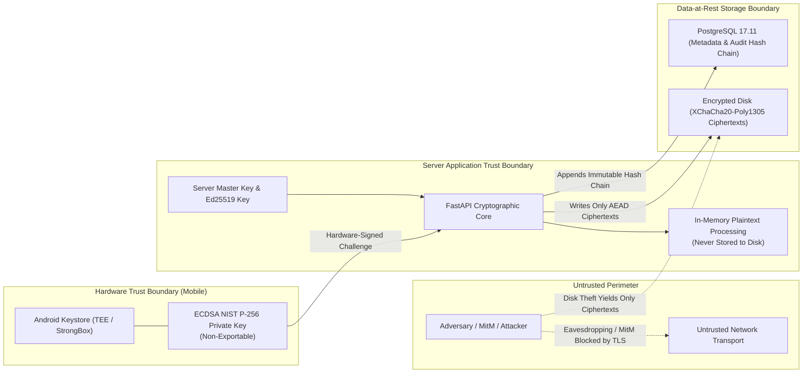
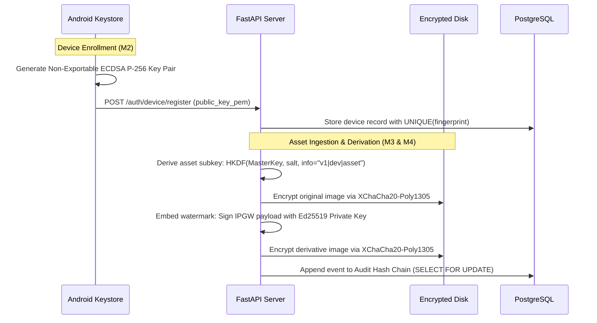

# IPGuard — Security Architecture Documentation

**Document ID:** `docs/SECURITY_ARCHITECTURE.md`  
**Classification:** Cryptographic & Security Specification  
**Status:** Frozen & Verified (Milestones M0–M4)  
**Last Updated:** November 10, 2026  

---

## 1. Threat Model & Security Boundaries

IPGuard operates under a defense-in-depth model that assumes hostile network environments, untrusted server administrators with physical access to raw storage disks, and malicious clients attempting unauthorized file tampering.



### 1.1 Addressed Threat Vectors
1. **Credential Interception & Replay Attacks:** Eliminated by eliminating static passwords. Authentication relies on ephemeral nonces signed within hardware TEE.
2. **Session Hijacking & QR Phishing:** Mitigated via Anti-QR Jacking secrets (SEC-02), browser origin enforcement, and short challenge lifetimes (60s TTL).
3. **Data Exfiltration at Rest:** Stored digital assets are protected using authenticated symmetric encryption (AEAD). Exfiltration of the raw disk yields only ciphertext blocks.
4. **Attribution Forgery & Covert Removal:** Digital watermarks are embedded directly into spatial pixel bits with 256-bit Ed25519 digital signatures. Any pixel alteration breaks signature verification.
5. **Audit Log Tampering:** System events are recorded in an append-only hash chain with pessimistic row locks, preventing retroactive history modification.

---

## 2. Cryptographic Primitives & Specifications

| Security Domain | Cryptographic Primitive | Parameters / Standard | Purpose |
| :--- | :--- | :--- | :--- |
| **Device Authentication** | ECDSA NIST P-256 | `secp256r1`, SHA-256 digest | Signs out-of-band challenge nonces in Android Keystore |
| **Asset Storage Encryption** | XChaCha20-Poly1305 | 256-bit key, 192-bit nonce, 128-bit MAC | Authenticated encryption of master and derivative assets at rest |
| **Secure Notes Encryption** | AES-256-GCM | 256-bit key, 96-bit IV, 128-bit Tag | Authenticated encryption of user text notes |
| **Key Derivation** | HKDF-SHA256 | RFC 5869, info=`v1\|device_id\|asset_id` | Derives unique deterministic subkeys per asset and device |
| **Steganographic Attribution** | Ed25519 | Edwards-curve (RFC 8032), 256-bit | Digitally signs `IPGW` binary watermark payloads |
| **Payload Integrity** | SHA-256 | FIPS 180-4, 32-byte digest | Checksums for asset bytes and watermark binary payloads |
| **Audit Ledger** | Rolling Hash Chain | `H_n = SHA-256(H_{n-1} \|\| EventData)` | Cryptographic append-only chain guaranteeing non-repudiation |

---

## 3. Key Management Lifecycle



### 3.1 Device Private Keys
- Generated and retained strictly within the hardware-backed Android Keystore (`KeyGenParameterSpec`).
- Configured with `PURPOSE_SIGN`, digest `SHA-256`, and invalidated on app uninstall.
- Private key bytes cannot be extracted by the OS or user space (`privateKey.encoded == null`).

### 3.2 Server Master Encryption Key
- 32-byte CSPRNG key supplied via environment variable `VAULT_MASTER_KEY_HEX`.
- Strict startup validation: development keys are prohibited in production mode.
- Subkeys are derived deterministically on-the-fly using HKDF-SHA256 with domain-separated info strings, preventing key reuse across assets.

### 3.3 Steganographic Signing Key
- Server maintains an active Ed25519 signing key (`STEGO_SIGNING_PRIVATE_KEY_B64`) identified by `STEGO_ACTIVE_KEY_ID`.
- Public keys are maintained in a verified key registry (`STEGO_PUBLIC_KEYS_JSON`) allowing seamless verification and future key rotation.

---

## 4. Steganographic Watermark Binary Layout (`IPGW` v1)

Every embedded watermark binary payload adheres to the strict 170-byte header format:

```
+-----------------------------------------------------------------------+
|  Offset  | Size (Bytes) | Field Name            | Description         |
+-----------------------------------------------------------------------+
|  0..3    |      4       | Magic Bytes           | ASCII "IPGW"        |
|  4..5    |      2       | Format Version        | Big-endian uint16=1 |
|  6..37   |     32       | Watermark UUID        | Binary UUID bytes   |
|  38..69  |     32       | Source Asset UUID     | Binary UUID bytes   |
|  70..101 |     32       | Derivative Asset UUID | Binary UUID bytes   |
|  102..105|      4       | Key ID Length         | Big-endian uint32   |
|  106..137|     32       | Key ID                | UTF-8 string bytes  |
|  138..141|      4       | Payload Length (L)    | Big-endian uint32   |
|  142..173|     32       | Payload SHA-256       | Cryptographic digest|
|  174..X  |      L       | JSON Payload          | Metadata string     |
|  X..X+64 |     64       | Ed25519 Signature     | Digital Signature   |
+-----------------------------------------------------------------------+
```

### Invariant Rules:
1. **Transparency Preservation:** Alpha channels ($A$) in RGBA images are strictly untouched to prevent visual masking artifacts.
2. **Channel Capacity Check:** The required carrier capacity ($W \times H \times 3 \text{ bits}$) must strictly exceed total framed payload length ($170 + L + 64 \text{ bytes} \times 8$).
3. **Fail-Closed Verification:** Any discrepancy in magic bytes, SHA-256 payload digest, or Ed25519 signature immediately rejects extraction with HTTP 409 Conflict.

---

## 5. Audit Hash Chain Integrity

The audit logging mechanism records every administrative and asset operation in an immutable chain:

$$\text{EventHash}_0 = \text{SHA-256}(\text{"GENESIS"} \parallel \text{genesis\_data})$$
$$\text{EventHash}_n = \text{SHA-256}(\text{EventHash}_{n-1} \parallel \text{Payload}_n \parallel \text{Timestamp}_n)$$

- **Concurrency Control:** Updates acquire a pessimistic row lock (`SELECT * FROM audit_chain_heads WHERE chain_name = 'default' FOR UPDATE`).
- **Chain Verification:** Continuous verification checks confirm that every record's `prev_event_hash` matches the preceding record's `event_hash`.
- **Tamper Evidence:** Any modification of past rows breaks all subsequent hashes in the chain, enabling instant detection of database-level tampering.

---

## 6. Cryptographic Scope & Documented Limitations

1. **LSB Fragility:** Spatial LSB steganography is intentionally fragile. Any lossy compression (JPEG, WebP), spatial resizing, or filtering modifies pixel bit values and breaks signature verification.
2. **Attribution Semantics:** An Ed25519 signature proves mathematical authenticity under the trusted key. It does not replace statutory copyright registration with judicial bodies.
3. **Native Biometrics:** Native biometric gating (`BiometricPrompt`) on Android is planned for future milestones; current implementation uses hardware Keystore authentication without mandatory biometric enrollment.
