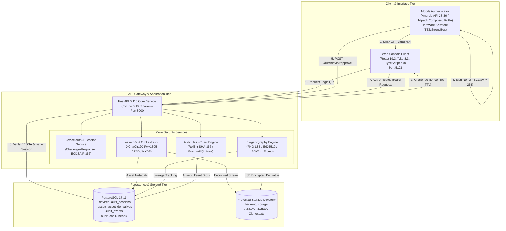

# IPGuard — System Architecture Documentation

**Document ID:** `docs/SYSTEM_ARCHITECTURE.md`  
**Classification:** Technical Architecture Specification  
**Status:** Frozen & Verified (Milestones M0–M4)  
**Last Updated:** November 10, 2026  

---

## 1. Architectural Vision & Scope

IPGuard is an end-to-end secure digital asset protection platform designed to enforce non-repudiable ownership, confidentiality at rest, and tamper-evident attribution for sensitive digital media and intellectual property.

The system addresses the threat model of centralized file distribution by integrating:
1. **Out-of-band Hardware Authentication (M2):** Android Keystore cryptographic challenge-response via dynamic QR codes.
2. **Authenticated Zero-Knowledge Storage (M3):** Client-specific authenticated encryption using XChaCha20-Poly1305 with per-device key derivation.
3. **Imperceptible Cryptographic Steganography (M4):** Edwards-curve signed (Ed25519) least-significant-bit watermarking embedded into truecolor PNG carrier images, anchored by an append-only cryptographic audit hash chain.

---

## 2. High-Level Component Topology



---

## 3. Subsystem Breakdown

### 3.1 Web Console Client (`frontend/`)
- **Technology:** React 19.3.1, TypeScript 7.0.2, Vite 8.3.6, Tailwind CSS 4.3.4, TanStack Query 5.x.
- **Responsibilities:**
  - Dynamic QR code polling and session lifecycle management (`sessionStorage`).
  - Interactive Digital Asset Vault: drag-and-drop file upload, raster image previewing, watermark parameter configuration.
  - Watermark operations: embedding trigger, cryptographic verification modal, payload extraction display, and decrypted byte-for-byte asset downloads.
  - Responsive visual filtering across all assets, watermarked derivatives, and original masters.

### 3.2 Mobile Hardware Authenticator (`mobile-authenticator/`)
- **Technology:** Android SDK (API 28–36), Kotlin, Jetpack Compose, CameraX, ZXing core, Android Keystore provider.
- **Responsibilities:**
  - One-time device registration generating non-exportable ECDSA NIST P-256 key pairs inside hardware TEE/StrongBox.
  - Real-time QR barcode scanning of web login challenges.
  - Nonce validation, device approval, and cryptographic signature generation over SHA-256 challenge digests.

### 3.3 Backend API Service (`backend/app/`)
- **Technology:** Python 3.13.2, FastAPI 0.115, SQLAlchemy 2.0, Psycopg 3, Pydantic v2, Pillow 11.x, PyCA/cryptography.
- **Subsystem Implementations:**
  - `app.api.routes`: REST endpoints for auth, assets, secure notes, steganography (`/embed`, `/verify`, `/extract`), and health probes.
  - `app.services.assets`: Secure file ingestion, streaming in-memory encryption/decryption, orphan cleanup, and deletion safety.
  - `app.services.png_steganography`: Low-level pixel manipulation, `IPGW` binary framing, RGBA channel boundary preservation, and Ed25519 signing.
  - `app.services.steganography`: Business orchestration connecting asset storage, derivative registration, and audit recording.
  - `app.services.audit_chain`: Append-only audit log with pessimistic database row locks (`SELECT FOR UPDATE`) ensuring linear chain integrity under high concurrency.

### 3.4 Storage & Database Tier
- **Database:** PostgreSQL 17.11 with 9 strictly sequenced Alembic migrations (`0001_initial_schema` through `0009_png_lsb_derivatives`).
- **File Store:** Server-side filesystem storage (`backend/storage/`) containing only encrypted payloads (nonce + ciphertext + MAC). Original master plaintext files are never persisted to disk unencrypted.

---

## 4. Milestone Integration Mapping

| Milestone | Capability | Key Architectural Modules | Primary Artifacts |
| :--- | :--- | :--- | :--- |
| **M0** | Hardware Feasibility | Android Keystore feasibility, CameraX barcode vision | [`M0_TECHNICAL_FEASIBILITY.md`](M0_TECHNICAL_FEASIBILITY.md) |
| **M1** | Foundation & Security | FastAPI core, configuration, error handling, DB baseline | [`M1_TEST_REPORT.md`](M1_TEST_REPORT.md) |
| **M2** | Device Authentication | Android Authenticator, QR handshake, ECDSA P-256 | [`M2_ARCHITECTURE.md`](M2_ARCHITECTURE.md), [`M2.4C_WEB_ARCHITECTURE.md`](M2.4C_WEB_ARCHITECTURE.md) |
| **M3** | Secure Asset Vault | XChaCha20-Poly1305 AEAD, HKDF key derivation, Notes | [`M3_FINAL_SECURITY_REVIEW.md`](M3_FINAL_SECURITY_REVIEW.md), [`M3_ALIZA_ASSET_VAULT_INTEGRATION.md`](M3_ALIZA_ASSET_VAULT_INTEGRATION.md) |
| **M4** | Cryptographic Stego | PNG LSB framing (`IPGW`), Ed25519, Audit Hash Chain | [`M4_BACKEND_IMPLEMENTATION_REPORT.md`](M4_BACKEND_IMPLEMENTATION_REPORT.md), [`png-lsb-steganography.md`](png-lsb-steganography.md) |

---

## 5. Technology Stack Specifications

| Layer | Component | Version / Specification | Rationale |
| :--- | :--- | :--- | :--- |
| **Frontend** | React | 19.3.1 | Concurrency features, efficient component rendering |
| | Vite | 8.3.6 | Ultra-fast HMR and optimized production bundling |
| | TypeScript | 7.0.2 | Static typing and interface enforcement |
| | Tailwind CSS | 4.3.4 | Modern utility-first responsive interface design |
| **Backend** | Python | 3.13.2 | Asynchronous performance and modern language features |
| | FastAPI | 0.115.11 | High-performance asynchronous REST API framework |
| | SQLAlchemy | 2.0.38 | Asynchronous and synchronous ORM with strict typing |
| | PyCA Cryptography| 44.0.2 | Production-grade libsodium/OpenSSL cryptographic primitives |
| | Pillow | 11.1.0 | Accurate truecolor raster manipulation and lossless PNG parsing |
| **Database** | PostgreSQL | 17.11 | ACID compliance, robust row locking (`FOR UPDATE`), JSONB support |
| | Alembic | 1.15.1 | Repeatable and versioned schema evolution |
| **Mobile** | Android OS | API 28 (Pie) to API 36 | 95%+ device market coverage with hardware Keystore |
| | Kotlin | 2.0.21 | Type safety and idiomatic Android Compose implementation |

---

## 6. Directory Structure & Code Organization

```
IPGuard/
├── backend/                  # FastAPI Application Core
│   ├── app/
│   │   ├── api/              # REST Endpoints (auth, assets, notes)
│   │   ├── core/             # Configuration, logging, security constants
│   │   ├── db/               # Alembic migrations (0001-0009), session factory
│   │   ├── models/           # SQLAlchemy ORM models (devices, assets, audit)
│   │   ├── schemas/          # Pydantic v2 validation models
│   │   └── services/         # Cryptographic & business logic
│   ├── storage/              # Encrypted asset files at rest
│   └── tests/                # 209 automated pytest test suites
├── frontend/                 # React 19 Web Console
│   ├── src/
│   │   ├── components/       # UI widgets, modals, layout
│   │   ├── pages/            # Auth and Asset Vault views
│   │   ├── services/         # Axios API clients
│   │   └── types/            # TypeScript interfaces
├── mobile-authenticator/     # Android Native Client (Kotlin / Compose)
├── docs/                     # Technical specifications, reports, and evidence
│   └── screenshots/          # Real browser test evidence
└── scripts/                  # Automated verification and acceptance runners
```
