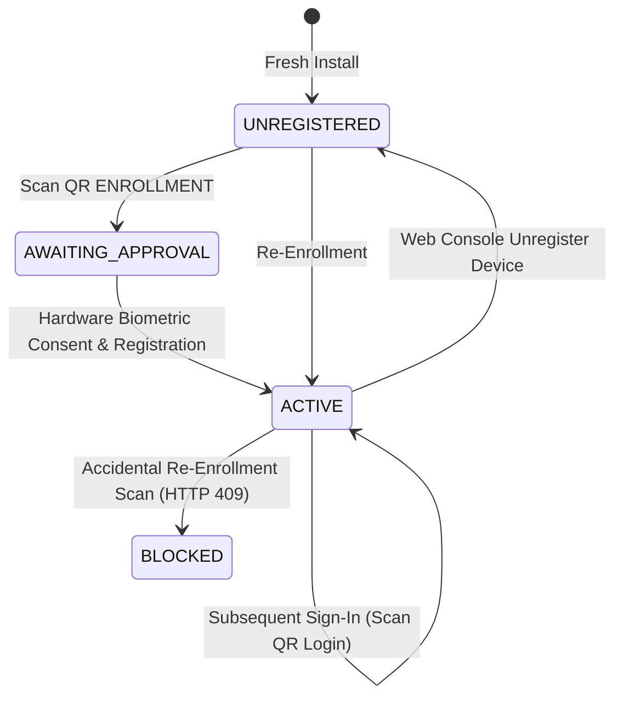

# IPGuard Authenticator

Native Android hardware authenticator application for IPGuard zero-trust account and digital asset security.

**Application ID:** `com.ipguard.authenticator`  
**Current Milestone:** M2 Native Face Authentication (`BiometricPrompt`) & Authenticator UI Redesign  
**App Version:** `0.5.0` (`versionCode 5`)  
**Target API:** Compile SDK 36, Target SDK 36, Minimum SDK 28  
**Verification Status:** 68 Unit Tests Passed (100% green across 11 suites); Native Face Gate + Keystore ECDSA signing verified on Samsung Galaxy A54 5G (`SM-A546E`, Android 16)

---

## 1. Overview & Security Architecture

The IPGuard Authenticator transforms an Android smartphone into a physical hardware security token. Unlike software authenticators that store exportable secrets or rely on SMS OTPs, IPGuard enforces:
- **Non-Exportable Keystore Keypairs:** Cryptographic private keys (NIST P-256 `secp256r1`) generated inside the device's Trusted Execution Environment (TEE) or StrongBox Keymaster/Keymint hardware security module.
- **Hardware-Level Biometric / Credential Authorization:** Out-of-band challenge signing secured via `BiometricPrompt` with `CryptoObject` (Class 3 strong biometrics or hardware Gatekeeper PIN/pattern/password).
- **One-Time Device Enrollment:** A device registers its public key once. After successful enrollment, the device transitions to `ACTIVE` status and is permanently locked to **Sign In** mode only.
- **On-Device Vision Pipeline:** Zero-transmission QR barcode detection using Google ML Kit and CameraX.

---

## 2. Authenticator Lifecycle



### A. First-Time Device Enrollment
1. **Initial State:** On fresh install or after unregistration, the app status is `UNREGISTERED`. The Welcome screen presents **Set up this device**.
2. **Presence Gate & Scanner:** The user passes the front-camera presence check and scans an `ENROLLMENT` QR challenge generated on the IPGuard Web Console.
3. **Key Initialization:** The app checks the Android Keystore. If the signing key (`ipguard_device_signing_v1`) is absent, `ensureSigningKey()` generates a new ECDSA P-256 key pair inside the TEE/StrongBox marked `setUserAuthenticationRequired(true)`.
4. **Biometric Authorization:** The user confirms registration through `BiometricPrompt`.
5. **Registration Submission:** The app transmits the canonical challenge signature and base64 X.509 SubjectPublicKeyInfo DER public key to `POST /api/v1/auth/devices/register`.
6. **Active State:** The device transitions to **`ACTIVE`** status locally and in the PostgreSQL database.

### B. Subsequent Sign In
1. **Sign-In Only Lock:** Enrolled devices permanently lock the setup flow. The primary action on the Welcome screen becomes **Sign In (Scan QR)**.
2. **Login Challenge:** The user scans an `AUTHENTICATION` QR code displayed on the Web Console.
3. **Signing with Existing Key:** The app prompts for biometric/PIN authorization and signs the challenge using the pre-existing hardware signing key. The app **never generates a replacement key** for sign-in.
4. **Session Approval:** The signature is verified by the backend (`POST /api/v1/auth/sessions/{token}/verify`), authorizing the web console session.

### C. Re-Enrollment Rejection (`DEVICE_ALREADY_REGISTERED`)
If an already-registered device scans an enrollment QR code:
- The mobile client detects the active registration state and halts the flow immediately with:
  > *"Device Already Registered. This device is already linked to IPGuard. Please use Sign In."*
- If submitted to the backend, the PostgreSQL verifier applies pessimistic row-level locking (`SELECT ... FOR UPDATE`) and rejects the request with **HTTP 409 Conflict** (`DEVICE_ALREADY_REGISTERED`).

### D. Missing Signing Key Recovery
If the device is recorded as `ACTIVE` in backend records, but the signing key was deleted or lost from Android Keystore (e.g. following factory reset or app data wipe):
- Sign-in cannot proceed without the enrolled hardware private key.
- The app displays an alert informing the user that the device must be explicitly unregistered from the Web Console (**Device Management** -> **Unregister Device**) before fresh enrollment can be initiated.

---

## 3. Technology Stack

| Layer | Library / Component | Version | Purpose |
|---|---|---|---|
| **Language** | Kotlin | 2.2.21 | Primary application code |
| **UI Toolkit** | Jetpack Compose | BOM 2025.12.01 | Declarative Material 3 UI |
| **Navigation** | Navigation Compose | 2.9.8 | String-based type-safe screen routing |
| **Vision & ML** | CameraX | 1.6.2 | Camera preview and frame analysis |
| | Google ML Kit Barcode | 17.3.0 | On-device QR barcode parsing |
| | Google ML Kit Face | 16.1.7 | Local presence detection |
| **Security** | Android Keystore | API 28–36 | Hardware-backed key generation & storage |
| | AndroidX Biometric | 1.1.0 | BiometricPrompt with CryptoObject |
| **Networking** | OkHttp | 4.12.0 | Asynchronous HTTP client with connection pooling control |

---

## 4. Workstation & Environment Setup

Run the environment configuration script from the repository root to load the verified Java 17 and Android SDK toolchain:

```powershell
# From repository root:
. .\scripts\android-env.ps1
```

This exports:
- `JAVA_HOME=D:\Android\jdk-17`
- `ANDROID_HOME=D:\Android\Sdk`
- `ANDROID_SDK_ROOT=D:\Android\Sdk`

---

### 5. Build, Test, and Installation

### A. Run Automated Unit Tests
```powershell
Set-Location mobile-authenticator
.\gradlew.bat testDebugUnitTest --no-daemon
```
*Current test result: 68 passed across 11 test suites (including 9 tests in `BiometricFaceGateManagerTest`), 0 failures, 0 errors.*

### B. Assemble Debug APK (Internal Testing)
```powershell
.\gradlew.bat :app:assembleDebug --no-daemon
```
Outputs APK to:
`app\build\outputs\apk\debug\app-debug.apk`

### C. Signed Release APK & GitHub Releases Distribution

Signed release builds are generated exclusively via environment signing credentials or GitHub Actions (`../.github/workflows/android-release.yml`) — never with the debug keystore and never committing keystores or secrets to Git.

#### Required GitHub Repository Secrets
Configure these secrets in **Settings -> Secrets and variables -> Actions** before running `Android Release APK Build & GitHub Release`:
1. `ANDROID_KEYSTORE_BASE64`: Base64-encoded `.jks` / `.p12` release keystore (`base64 -w0 release.jks`).
2. `ANDROID_KEYSTORE_PASSWORD`: Password for the release keystore.
3. `ANDROID_KEY_ALIAS`: Key alias inside the keystore.
4. `ANDROID_KEY_PASSWORD`: Password for the release key alias.

#### Triggering a Release
Once secrets are configured:
- Run **Actions -> Android Release APK Build & GitHub Release -> Run workflow** (or push a release tag matching `v*-android*`, e.g. `v0.2.0-android-beta.1`).
- The workflow validates signing secrets, executes `testDebugUnitTest`, builds the signed release APK (`assembleRelease`), verifies signatures with `apksigner`, generates `SHA256SUMS.txt`, and publishes a GitHub Pre-release with `IPGuard-Authenticator-v0.2.0-beta.1.apk`.
- **Private Repository Access:** Because `Abhiprayaa29/IPGuard` is a **private** repository, users downloading APK assets from GitHub Releases must be signed in with repository read access. *(Note: No pre-release download URL is linked until signing secrets are configured in GitHub and the signed release workflow is executed.)*

#### Installation Instructions (Android)
1. Download the signed release APK (e.g. `IPGuard-Authenticator-v0.2.0-beta.1.apk`) and `SHA256SUMS.txt` from the GitHub Releases page once published (requires repository access).
2. Verify the SHA-256 checksum matches `SHA256SUMS.txt`.
3. Open the downloaded `.apk` file on your Android device (Android 9+ / API 28+).
4. Allow installation from the selected source if Android prompts for permission.
5. Open **IPGuard Authenticator** and follow **One-Time Device Enrollment** with Native BiometricPrompt + Android Keystore.

### C. Physical Device Installation & ADB Reverse
Connect your Android phone via USB with USB Debugging enabled:

1. **Verify device connection:**
   ```powershell
   adb devices -l
   ```
2. **Establish reverse loopback tunnel for backend API:**
   ```powershell
   adb reverse tcp:8000 tcp:8000
   adb reverse tcp:5173 tcp:5173
   ```
   *Verify active reverse port tunnels:*
   ```powershell
   adb reverse --list
   # Expected output:
   # UsbFfs tcp:8000 tcp:8000
   # UsbFfs tcp:5173 tcp:5173
   ```
3. **Install and launch the app:**
   ```powershell
   adb install -r app\build\outputs\apk\debug\app-debug.apk
   adb shell am start -n com.ipguard.authenticator/.MainActivity
   ```

---

## 6. Backend Connectivity Configuration

The mobile app resolves the backend API base URL using `BuildConfig.API_BASE_URL`.
- **Default (USB Loopback):** `http://127.0.0.1:8000/api/v1` (routes via `adb reverse tcp:8000 tcp:8000`).
- **LAN Override:** Provide the `IPGUARD_API_URL` environment variable during build if connecting over Wi-Fi:
  ```powershell
  $env:IPGUARD_API_URL = "http://192.168.1.100:8000/api/v1"
  .\gradlew.bat assembleDebug
  ```

---

## 7. Security Best Practices & Compliance

- **No Cleartext Credentials:** The main manifest restricts cleartext HTTP traffic. Development loopback (`127.0.0.1`, `localhost`) is explicitly scoped via `network_security_config.xml` under debug builds only.
- **Fail-Closed Policy:** Signature verification, session validation, and biometric authentication fail closed. If biometric authentication fails or is cancelled, no signature is generated.
- **No Export of Private Keys:** Private keys are generated with `KeyGenParameterSpec` and never exposed (`privateKey.encoded == null`).
- **Zero Credentials in Git:** Keystore files, private keys, device serial numbers, and session tokens are strictly excluded from git tracking.
