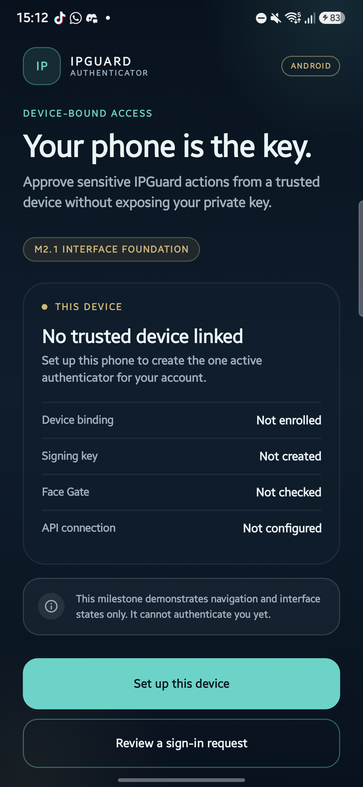

# IPGuard Authenticator

Native Android authenticator for IPGuard device-bound account access.

**Application ID:** `com.ipguard.authenticator`  
**Current milestone:** M2.1 — Authenticator Interface Foundation  
**App version:** `0.2.0` (`versionCode 2`)  
**Status:** M2.1 verified on a physical Samsung SM-A546E; M2.2 not started

> M2.1 provides navigation, interface states, and preview content only. Authentication, camera capture, QR decoding, biometrics, Android Keystore operations, networking, and challenge signing are not implemented yet.



## Stack

- Kotlin 2.2.21
- Jetpack Compose with Compose BOM 2025.12.01
- Material 3 and Material Icons Core
- Navigation Compose 2.9.8
- Lifecycle Runtime/ViewModel Compose 2.9.4
- Android Gradle Plugin 8.13.2
- Gradle 8.13 Wrapper with a pinned distribution checksum
- JDK 17
- Compile SDK 36, target SDK 36, minimum SDK 28

## Current Implementation

The single-activity application contains:

- A reusable navy–teal–gold design system.
- A string-based navigation graph.
- A lifecycle-aware preview ViewModel.
- Nine required screens: Welcome, Device Registration, Face Gate, QR Scanner, Authentication Request, Approval, Result, Device Information, and Security Settings.
- Three terminal result states: `scan_complete`, `approved`, and `rejected`.
- Device facts from `Build` and the application version from `BuildConfig`.

Every flow is intentionally non-functional. The UI displays sample data and explicit preview notices; it does not contact an account, open a camera, request biometrics, create a key, sign a challenge, or create a session.

## Prerequisites

- Android SDK Platform 36 and Build Tools 36.0.0
- JDK 17
- A connected physical Android device with USB debugging enabled
- PowerShell 5.1

The workstation's local toolchain is under `D:\Android`. Use the repository environment script rather than the global Java 22 installation.

## Environment

From the repository root:

```powershell
. .\scripts\android-env.ps1
```

This sets `JAVA_HOME`, `ANDROID_HOME`, `ANDROID_SDK_ROOT`, `ANDROID_USER_HOME`, `GRADLE_USER_HOME`, and the current-process PATH. The script also sets `$ErrorActionPreference = 'Stop'`; scripts that expect native stderr output should change that preference after loading it.

## Build and Verify

```powershell
Set-Location C:\Users\user\Documents\02_Projects\IPGuard\mobile-authenticator
. ..\scripts\android-env.ps1

.\gradlew.bat :app:assembleDebug
.\gradlew.bat :app:lintDebug
```

APK:

```text
app\build\outputs\apk\debug\app-debug.apk
```

Install and launch on the connected physical device:

```powershell
adb devices -l
adb install -r app\build\outputs\apk\debug\app-debug.apk
adb shell am start -W -n com.ipguard.authenticator/.MainActivity
```

Do not record the device serial number in project files.

## Tests and Reports

M2.1 evidence:

- [M2.1 architecture](../docs/M2_ARCHITECTURE.md)
- [M2.1 test report](../docs/M2_TEST_REPORT.md)
- [M2.1 screenshots](../docs/assets/m2.1/)

Historical M2.0 evidence:

- [Android setup](../docs/M2_ANDROID_SETUP.md)
- [Environment report](../docs/M2_ENVIRONMENT_REPORT.md)
- [M2.0 build probe](../docs/assets/m2.0-build-probe.png)

M2.1 verification passed on the physical device: debug build, lint with 0 errors, installation, cold launch, all nine screens, setup/approval/rejection flows, terminal result back behavior, and no fatal exception. Authentication and hardware-security behavior remain **NOT TESTED**.

## Security Notes

- Debug builds only.
- No authentication logic, private key, or signing operation exists in M2.1.
- Application backup and device-transfer extraction are disabled.
- Cleartext HTTP is disabled in the main manifest.
- Camera and biometric permissions are declared for later milestones but are not requested or exercised.
- Preview results always report that no authentication, key use, or session creation occurred.
- Never commit `local.properties`, build outputs, APKs, keystores, or device identifiers.

## Project Layout

```text
mobile-authenticator/
├── app/
│   └── src/main/
│       ├── AndroidManifest.xml
│       ├── java/com/ipguard/authenticator/
│       │   ├── MainActivity.kt
│       │   ├── IPGuardApp.kt
│       │   ├── navigation/
│       │   ├── ui/components/
│       │   ├── ui/screens/
│       │   ├── ui/state/
│       │   └── ui/theme/
│       └── res/
├── gradle/wrapper/
├── build.gradle.kts
├── settings.gradle.kts
├── gradle.properties
├── gradlew
└── gradlew.bat
```
